# Oratcl User's Guide and Reference

### Scripting Oracle applications with the Tcl/Tk language

By Todd M. Helfter

> Converted to Markdown from the original 87-page "Oratcl User's Guide and Reference"
> (Revision 8, OpenOffice.org 3.1, originally authored 2009). The source PDF circulated
> publicly includes an identifying home mailing address on its title page, which has been
> redacted both here and from the archived PDF kept alongside this file
> (`Oratcl_Users_Guide_and_Reference.pdf`). Figures/screenshots from the original are noted
> as captions but not reproduced inline. See also the condensed [doc/oratcl.html](oratcl.html)
> man-page-style reference and [doc/FAQ.html](FAQ.html).

## Preface

Tcl is an extraordinary scripting language superior to many other Unix shell languages. It was created by John Ousterhout in the late 80’s. A comprehensive History of Tcl is available in John’s own words from: http://www.tcl.tk/about/history.html

Without this original spark of creative genius and that of Oratcl’s creator Tom Poindexter, there would be no point to this book.

This book is meant to be a guide to all levels of expertise in using the functionality provided by the Oratcl extension of the TCL language. It is assumed that the reader of this book will have a basic understanding of the use of the TCL language. This book will not attempt to instruct in the use of TCL beyond the examples required to demonstrate how to use TCL to interact with the Oracle database. There are many fine books on the Tcl language, I personally can recommend “Practical Programming in TCL and TK” by Brent B. Welch, Ken Jones and Jeffrey Hobbs.. It is particularly important for those considering the use of Oratcl to understand the use of TCL, especially it’s concepts of lists, hashes, and string manipulation.

## Acknowledgments

There are several individuals and organizations I need to thank. I’m sure that there are many more of you, please don’t feel left out.

Tom Poindexter : Tom is the creator and first advocate of Oratcl. He was involved with this project long before I came along. I would like to thank him for his efforts and support and for always having the time for a newcomer with some upgrade requests. Tom asked me to take over as the project administrator in 1999, and since that time, I’ve tried to keep Oratcl as close to his original design as possible.

Purdue University : In the mid 90’s, I became involved with a project at Purdue University called ACmaint 3.0. This project used embedded Tcl interpreters and was designed to be database agnostic. As a database developer with a track record, I was added to the development team to work on migration methods from an older version and Oracle integration and performance tuning. The original design used a pseudo- tty running Sql*Plus and a series of pipelines to allow Tcl (version 7.2) to pattern match the output into success or failure results. The addition of Oratcl to this process allowed for a 60% performance increase. The University as a whole benefited from Oratcl, but personally I must thank a few individuals: John Steele, Scott Ksander and Rob Stanfield for creating a work environment where personal IT interests could be pursued. Go Boilers

DataPipe : My current employer DataPipe is supporting my efforts to write this book with donated hardware and personal encouragement.

My wife Anne : For always suggesting I can do things a little bit better, and for unfailingly showing interest in my computer hobbies.

## Extending TCL

Tcl is an interpreted language. Tcl is embeddable and extensible, and has been widely used since its creation in 1988 by John Ousterhout. There are many available extensions to the Tcl language. Since the addition of the loadable package mechanism to Tcl, these extension are now referred to as packages. Before the package command was added, ‘C’ based extensions to the Tcl language had to be compiled and linked into the Tcl shell program. Thus it is common to see references to ‘oratclsh’ in the early documentation of the Oratcl extension. In fact, Oracle corporation still includes an ‘oratclsh’ program with the database up to and including Oracle 11g. This version of the Oratcl extension is quite old and has some non-public functionality added to it by Oracle. Checking my 11g database, I see that the provided oratclsh uses Tcl version 8.2.3. and a customized Oratcl version, I believe based on the Oratcl 2.3 release. I will have to get Tom Poindexter to confirm.

Tom Poindexter adds the following historic recollection of his efforts.

“I started development of Oratcl after the project I was working on at the time began using Oracle as a database system during the summer of 1993. I had been using Tcl for about one and a half years at a previous job, where I developed Sybtcl, a Tcl interface to the Sybase database system. Developing Sybtcl, and applications using Tcl/Tk and Sybtcl, proved to me that Tcl/Tk was a great tool for rapid development of systems and application programs.”

“I borrowed heavily from Sybtcl while I was developing Oratcl. While the two C interfaces libraries (DB-Lib for Sybase, OCI for Oracle) were quite different, the structure of the two Tcl interfaces roughly followed the same principles, namely that interface should simplify common tasks, while still allowing the programmer access to database specific functionality. In November 1994, I started a consultantcy practice, and landed a long term contract at a large company that had both Sybase and Oratcl database systems, to I was able to make enhancements to both Sybtcl and Oratcl during that time, until 2001 when I closed my consultantcy to join a local technology start-up.”

“I wasn't aware of Oracle developers using Oratcl until I received an email from one of the Oracle Enterprise Manager (OEM) developers. He told me that his team was using Tcl and Oratcl to build the next version of that product (I seem to recall that the first email from the OEM developer was in 1995.) I only exchanged brief emails with that developer, and a patch or two. One of the more strange emails was from Oracle's legal department, asking *me* to accept liability for Oracle using my code. I replied that Oracle was free to use my software, as long as they abided by the terms of the Oratcl license agreement, which was similar to the Tcl/Tk license agreement at the time (BSD style license, but with a notice clause to be printed in any documentation.) Oracle did publish the Oratcl copyright notice in the Oracle Enterprise Manager Administrator's manual for many years, until the original OEM functionality was deprecated by newer code. I believe Oracle continues to ship Tcl and Oratcl code in recent versions, at least the last time I checked.”

My own efforts were a little vague in my own mind. However, having found my old email archive, I've dug up the following efforts.

- Aug. 1997 – Worked with Tom Poindexter to get Oratcl to work with Oracle 7.3 on Windows 95.

- Aug. 1997 – Contributed the idea and sample code for 'orabindexec' and 'orasql -parseonly'. Tom chose a slightly different implementation from the sample code. This came about from a need to batch process a lot of data with Oratcl. (First seen in Oratcl 2.5b1 and working in 2.5b2)

- Aug. 1997 – Bug report : Oratcl caused page fault in Wish4.2 on windows, leaving child processes running in the background. Tom fixed in Oratcl 2.5b2

- Sep. 1998 – Oratcl takes on a large role in batch processing of various education computing tasks at Purdue University.

- Oct. 1998 – Bug report that orafetch mis-handled arguments in Tcl 8.0. Especially after an oraplexec call.

- Dec. 1998 – contributed the first test suite for Oratcl 2.5

- Dec. 1998 – in combination with another developer (John Jackson), contributed an oratcl based DB-backup for Oracle hot backups to the Amanda software community.

- Jul 1999 – Very, very early stab at Oratcl 2.5 in a 64b Solaris (2.7) environment with Tcl8.2

- Jul. 1999 – Scriptics corp. took over responsibility for Oratcl CVS repository.

- Aug. 1999 – A joint effort between myself and John Jackson at Purdue University, we contributed the 'oraldalist' and 'oracurlist' functions for Oratcl 2.6. Corrected the argument handling of the Oratcl_Fetchall() 'C' routine to properly handle list arguments. Removed several calls to strcpy(), bcopy() and memset() for even better performance. And utilized GetListObjElements() instead of the older string based version SplitList() for proper return values from Orafetch().

- Aug. 1999 – Determined that calling TclpUnloadFile() on the Oracle library file caused core dumps on exit. (This condition existed up through Oracle 9i and possibly 10). This was caused by the Oracle library performing an atexit() call. If the library was unloaded, the atexit() was pointing to a null address and core dumped. This all started with some of the new features of Tcl 8.1.0 and did not occur in Tcl 8.0.5. As a result the Tcl team rewrote the package commands to allow the unload to be skipped.

- Aug. 1999 – Contributed the code for Oratcl 2.6 to use Tcl slave and secure interpreters. Improved the 'oraopen' command to only allow it to open statement handles on login handles opened in the same interpreter. Enhanced the oralogoff command to only close connections opened in the same interpreter.

- Apr. 2000 – Converted Oratcl to use OCI8, released as Oratcl 2.8 and shortly after, renamed to Oratcl 3.0 by request for Tom Poindexter. This was primarily because 3.0 was not 100% backwards compatible with 2.x. It was at this time that Tom officially passed the 'official developer' torch for Oratcl to me.

- Jun 2000 – Oratcl 3.0 released for production.

- Aug 2001 – Oratcl 4.0 released, this is the first thread-safe version of Oratcl, compatible with the 'thread' Tcl package.

## Oratcl Release History

Version 1.0, July, 1993 Version 2.0, November, 1993 Version 2.1, February, 1994 Version 2.11, April, 1994 Version 2.2, October, 1994 Version 2.3, August, 1995 Version 2.4, September 1996 Version 2.41, December 1996 Version 2.5, November 1997 Version 2.6 September, 1999 Version 2.7 August, 1999 Version 3.0 June, 2000 Version 3.0.1 August, 2000 Version 3.1 October, 2000 Version 3.2 March, 2001 Version 3.3 August, 2001 Version 4.3 November, 2004 Version 4.4 March, 2005

Getting Started with Oratcl

## Minimum Requirements for proper Oratcl operation

Before we can start with the programming examples, we must first make sure that our environment has the minimum requirements for the examples to function. There are three basic requirements that must exist in the environment before we can write Oratcl applications.

1. a Tcl/Tk installation

2. the Oratcl package

3. an Oracle client

The versions of these individual pieces will determine the list of features available. Let’s work through some sample architectures and configurations. Each of these three items are loaded in states.

## Tcl / Tk

First a Tcl shell is created, typically with the tclsh (tclsh84.exe on windows, tclsh8.4 on unix) command. After Tcl is running we instruct Tcl to load the Oratcl package via the package require Oratcl command. When the environment is properly initialized, the Oratcl library will dynamically link to the Oracle client library at this time, when successful, package require returns the version number of the package loaded. When the environment is not correct, the Oratcl package will fail to load at which time an error will be displayed.

## MS Windows XP, 2000, 2003

The quickest and easiest way to prepare a MS Windows system is to obtain and install two pre-packaged download files. First we will take care of requirements one and two. To do so, we can use ActiveTCL for windows which includes a Tcl shell, a Tk gui console, and it includes Oratcl as well as many other popular extensions.

For this demonstration I obtained a copy of the prepackaged installer program ActiveTcl8.4.14.0.272572- win32-ix86-threaded.exe from the ActiveState web site: http://www.activestate.com/downloads .

### ActiveTcl Installation

Follow the download instructions on the ActiveState site. And run the installer. You may modify the installation options, but I chose all the defaults for the examples in this book. Like most MS windows based

software, The ActiveTcl installer will add menu items to the Windows ‘Start Menu’ and includes options for uninstalling. Navigating through the start menu, select Tclsh8.4 and a Tcl shell window will be started.

.

*Figure 1 the ActiveTcl installation*

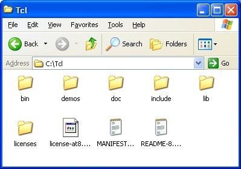

*Figure 2 the Oratcl installation*

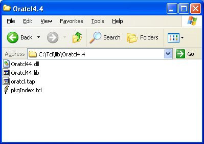

Since Oratcl is a dynamically loaded library, on windows it will have two required files; the Oratcl44.dll file and the pkgIndex..tcl file which provides the package loading instructions to Tcl’s package loading mechanism. By convention, these files are located in their own directory inside the Tcl\lib folder. Using the tclsh84.exe shell program we can attempt to load the Oratcl package into Tcl with the package require syntax..

*Figure 3 tclsh84.exe window with error message*

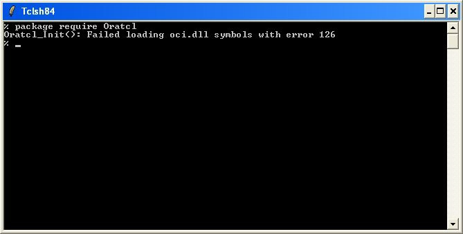

This error is entirely expected, since we have not yet installed the oracle client software. If your server already has an Oracle client and you still have this error, skip past the instant client install to the trouble shooting section.

### Oracle Instant Client for Windows Installation

For this chapter’s exercise, I downloaded the Oracle instant client software from this URL:

http://www.oracle.com/technology/tech/oci/instantclient/index.html

The instant client download site requires that you create an Oracle Technology Network identity. While I was there, I obtained all the windows related instant client files, however only one file, the instant client basic is needed. Since my MS Windows computer is a 32-bit platform. I downloaded and uncompressed instantclient- basic-win32-10.2.03-20061115.zip

Oracle provides several instant client download files that provide additional functionality. The Sql*Plus files are helpful for database connection debugging and for running ad-hoc queries, but they are not required for Oratcl. Likewise the odbc and jdbc downloads are also not required. All instant client downloads should be unzipped and copied into a single directory.

Before unzipping the instantclient-basic, I first created a C:\Oracle directory on my computer so that I can drag and drop the files from the provided zip file into this directory. When finished you should see something similar to my results.

*Figure 4 Oracle instant client install*

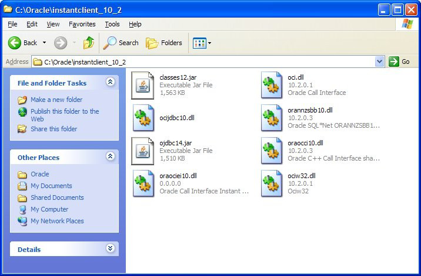

So let’s try the tclsh84.exe and package require commands again.

*Figure 5 tclsh84.exe with Oratcl installed and without oci.dll in the search path*


Again it has failed to load the Oracle library. I have forgotten one little detail specific to the MS windows environment. Windows will only load a dll that it can find in it’s search path. The default search path is the current working directory and locations defined in the system PATH environment variable. So simply changing to the oracle instant client directory allows windows to locate the oci.dll file. This of course is not a viable option in your programming scripts.

*Figure 6 tclsh84.exe with Oratcl installed after changing directory to oracle instant client location.*

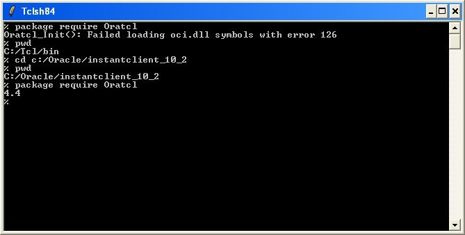

If you are planning to deploy applications to a windows environment with the Oracle instant client, there are a few options available. The easiest is to add the instant client location (in this case c:\oracle\instantclient_10_2) to the windows PATH environment variable. I have done so and the examples from this book will operate on the assumption that you have too. If your windows administrator will not let you adjust the system PATH variable, you can update the path variable in your Tcl script using a variety of variable commands (set, append) before loading the package. The following example demonstrates the append method.

*Figure 7 altering the env(PATH) variable so Windows will load oci.dll*

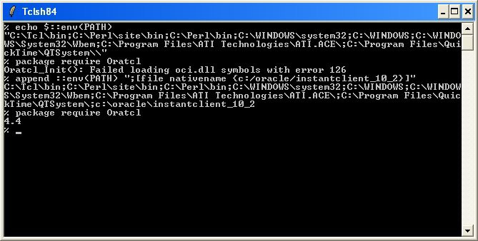

Success! From now on, we will be able to load Oratcl into our Tcl shells and start to make use of it’s features.

## Solaris 8,9 & 10

A little special consideration needs to be taken into account when working in a Sun Solaris environment. The most frequently asked question that I have seen regarding Oratcl on solaris has to do with 32 vs. 64 bit. Starting with 10g, Oracle stopped producing a 32 bit version of the database software for solaris, In 9i you could choose to install a 32 bit or a 64 bit version. This decision is most likely tied to the fact that Solaris 10 is only 64 bit as well. In Solaris 9, you could chose to operate in 32 bit or 64 bit mode, so both versions of the Oracle database had to be produced. Oratcl is fully capable of functioning in both modes, but must be compiled properly to do so. In fact, if Oracle, Tcl and Oratcl are all 32 bit or all 64 bit, nothing special has to be done at all. Later in this section, I’ll explain how to use a 32bit Tcl/Oratcl combination with a 64bit database. For now, lets focus a little bit on how to build the various versions. Luckily, it is very easy to build software in the unix environment with a few commonly installed utilities. Source code for Tcl and Oratcl is available from the SourceForge group pages for each package and also available via the anonymous CVS method.

First lets show the 64 bit build process for Sun Solaris. First we will create a work area to perform the compilations and obtain the software via CVS. In the anonymous CVS process we must first log in to the remote

source repository using a null password. (just hit enter). Then we can check out from the source tree the version of Tcl that we would like to use. We will also need to log into the Oratcl cvs repository.

First, there are some things about my environment that I need to convey. I have several packages installed (gcc, cvs). And a little configuration of my account as well. I have a $HOME/.cvsrc file with a few settings that I find helpful. Please check the CVS man page or a reference book for specifics. I include this here so that those following along the book will see the same results that I do.

```
cvs -z9 –q
update -Pd
checkout -P
rtag -a
```

I have a Solaris 10 installation and Oracle 10g database install. It is essential that the ORACLE_HOME environment variable be set in your configuration.

One additional point of interest. You do not need any Oracle software installed on the server to compile Oratcl. As demonstrated in the Windows section, Oratcl dymanically loads the Oracle client libraries at run time. So it is possible to build the code on one server and replicate it to other servers in your environment.

```
jumpgate: [20] > uname -a
SunOS jumpgate 5.10 Generic_118833-24 sun4u sparc SUNW,Ultra-5_10
jumpgate: [21] > echo $ORACLE_HOME
/app/oracle/product/10.2.0/db_1
jumpgate: [22] > gcc -v
Reading specs from /opt/sfw/lib/gcc/sparc-sun-solaris2.10/3.4.2/specs
Configured
with:
../gcc-3.4.2/configure
--prefix=/opt/sfw
--with-
ld=/usr/ccs/bin/ld --with-gnu-as --with-as=/opt/sfw/bin/gas --enable-shared 
--disable-libgcj
Thread model: posix
gcc version 3.4.2
```

Note: for make install to work, /usr/ccs/bin needs to be in your $PATH

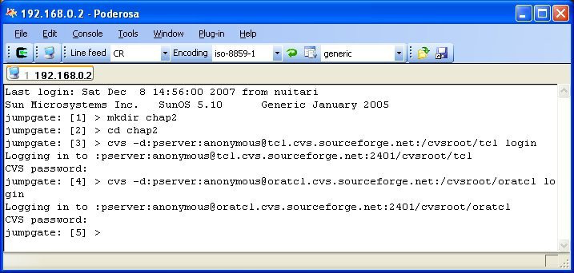

And as you can see from the previous example, the command line syntax can get very tedious. To assist with this, I use a little shell script that was written given to me by a Tcl developer many years ago. I call it ‘sfacvs’ (source forge anonymous cvs). And this greatly simplifies the whole CVS process for me. Here is the script. I place this script in my personal bin directory which I’ve added to my path.

```
#!/bin/bash
# sfacvs
rdir=$1
shift
cvs -d:pserver:anonymous@${rdir}.cvs.sourceforge.net:/cvsroot/$rdir $*
```

So here is the first example over again, using the script, much easier to perform, and much less likely to be frustrated with long command lines and mistyped arguments.

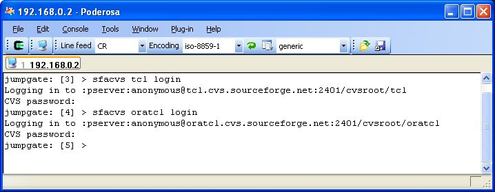

Now lets obtain the source code. For this operation it is useful to know some of the CVS tags, so that we can obtain specific versions. A tag is a way for source code developers to assign a consistent public label to a group of source files, so that when we check out that tag we get all the right files. Tcl tags follow this name scheme: core-MAJOR-MINOR-branch. So if, for instance, we want the Tcl 8.4 branch, the tag is core-8-4-branch.

```
core-8-3-branch
core-8-4-branch
core-8-5-branch
```

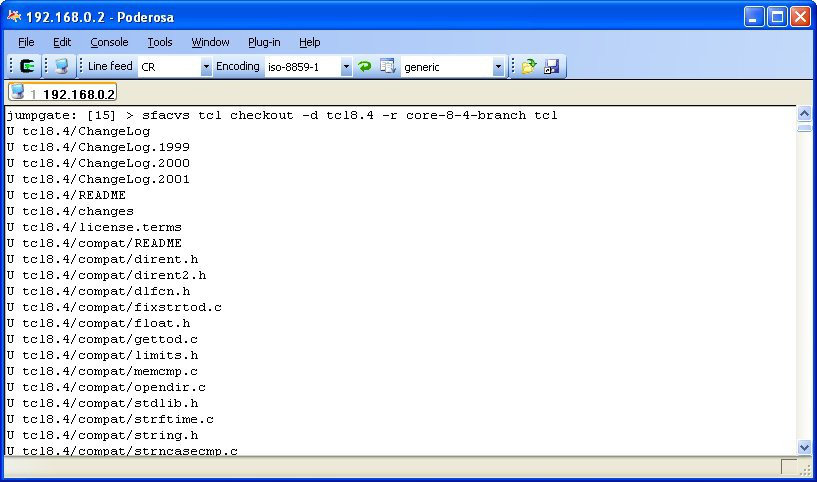

Oratcl uses a similar tag naming scheme: These are all the tags available in the CVS repository. Although all these versions are available via CVS. Each version has additional features and bug fixes available. The current version is 4.4, and that is the one we will use in this example. In a later chapter that covers the history and feature improvement of the various versions, there will be a compatibility matrix to assist with determining which versions are right for you. If you are just starting with a project, then the current production releases are Tcl 8.4.17 and Oratcl 4.4. These versions are fully compatible with the modern Oracle database versions 8i, 9i, 10g and 11g. If an older version of Oracle or legacy Oratcl code is being maintained, then the chapter on upgrading will be a good place to start.

```
scriptics-sc-2-7-branch
oratcl-3-0-branch
oratcl-3-0-1-branch
oratcl-3-1-branch
oratcl-3-2-branch
oratcl-3-3-branch
oratcl-4-0-branch
oratcl-4-1-branch
oratcl-4-2-branch
oratcl-4-3-branch
oratcl-4-4-branch
oratcl-4-5-branch (not yet created)
```

Utilizing the sfacvs script listed above, we must check out the Oratcl version we want to build.

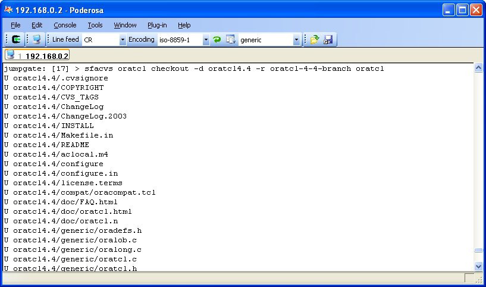

### Tcl Building and Installing

We now have all the source code we will need. So first we will build a 64 bit version of Tcl for solaris. To do so, we need to know where the software will be installed. The installing user has to have write access to the install location. For system administrators with root access, the install location can be one visible system wide. For those without root access, a location in your home directory can be a candidate. In this example I will use $HOME/app as the install location.

```
jumpgate: [23] > ls
./
../
oratcl4.4/
tcl8.4/
jumpgate: [24] > mkdir $HOME/app
jumpgate: [25] > cd tcl8.4/unix
```

Building Tcl is a three step process. A configure step that samples the environment, a make step to compile the code and an installation step. First we must run the configure utility to create the Makefiles. ./configure –help lists all the possible options. We need two of them for a 64bit Solaris build. These are –enable-64bit and --enable-64bit-vis

```
jumpgate: [26] > ./configure --prefix=$HOME/app/tcl8.4 --enable-64bit --enable-
64bit-vis
… snip …
jumpgate: [27] > make
… snip …
jumpgate: [28] > make install
… snip …
jumpgate: [29] > ls -al $HOME/app/tcl8.4/
total 12
drwxr-xr-x 6 tmh other 512 Dec 8 12:10 ./
drwxr-xr-x 3 tmh other 512 Dec 8 12:10 ../
drwxr-xr-x 2 tmh other 512 Dec 8 12:10 bin/
drwxr-xr-x 2 tmh other 512 Dec 8 12:10 include/
drwxr-xr-x 3 tmh other 512 Dec 8 12:10 lib/
drwxr-xr-x 5 tmh other 512 Dec 8 12:10 man/
```

I took the additional step of adding $HOME/app/tcl8.4/bin to my PATH environment variable.

```
jumpgate: [32] > which tclsh8.4
/export/home/tmh/app/tcl8.4/bin/tclsh8.4
jumpgate: [33] > tclsh8.4
% info patchlevel
```

8.4.17

### Oratcl Building and Installing

Now we can proceed with the Oratcl build using the same method as we did for Tcl (configure/make/make install).

```
jumpgate: [37] > cd chap2/oratcl4.4/
jumpgate: [38] > ./configure --prefix=$HOME/app/tcl8.4 --enable-64bit --enable-
64bit-vis
jumpgate: [39] > make
jumpgate: [40] > make install
```

When installed with this method, the Oratcl library files are placed in a directory located inside the Tcl lib directory. To be on the safe side lets compare the ELF versions for all the relevant files.

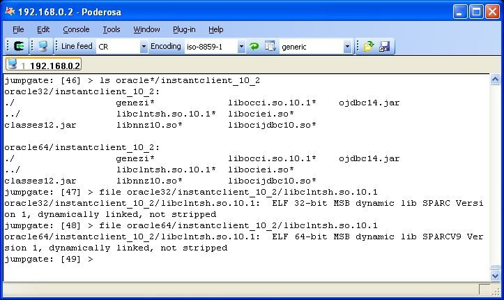

Ok we are good to go, all files have the same ELF version. We are ready for Oratcl scripting.

Success!

So now lets cover the alternative configuration. 32 bit Tcl and Oratcl with the 64 bit database. Since Oratcl dynamically loads the Oracle client library at run time, it has to know where to look for the file. Lucky for us, Oracle has provided a 32 bit compatibility library. In order for Oratcl to make use of this library, it has to know where to look for it. To simplify matters an additional environment variable is recognized by Oratcl to help with locating the Oracle client library. The variable ORACLE_LIBRARY should be set to the location of the Oracle client library libclntsh.so when needed. For this demonstration, I’ve compiled Tcl and Oratcl in 32 bit mode. The steps are the same as above, only the –enable-64bit and –enable-64bit-vis parameters are eliminated.

```
jumpgate: [93] > $HOME/app/tcl8.4-32/bin/tclsh8.4
% package require Oratcl
Oratcl_Init(): Failed to load /app/oracle/product/10.2.0/db_1/lib/libclntsh.so 
with
error
ld.so.1:
tclsh8.4:
fatal: 
/app/oracle/product/10.2.0/db_1/lib/libclntsh.so: wrong ELF class: ELFCLASS64
```

Well that clearly did not work. When Tcl is 32 bit and Oracle is 64 we have compatibility problems. Let’s provide a hint to Oratcl to look in a non-standard location, namely the 32 bit compatibility libraries provided by Oracle.

```
% set ::env(ORACLE_LIBRARY) $::env(ORACLE_HOME)/lib32/libclntsh.so
/app/oracle/product/10.2.0/db_1/lib32/libclntsh.so
% package require Oratcl
4.4
```

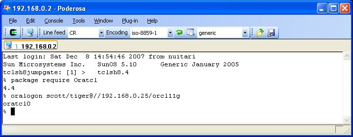

### Oracle Instant Client for Solaris Installation

It is often practical to use the Oracle Instant client for Solaris.: Oracle provides an instant download for the Solaris operating environment as well as many others. There are two versions to choose from: a 32-bit and 64-bit version. I downloaded both versions for this chapter. I began by creating an oracle32 and an oracle64 directory. I

placed each file in the respective directory and unzipped the archive. The archives unzip into an instantclient_10_2 directory.

```
jumpgate: [40] > ls oracle*/*.zip
oracle32/instantclient-basic-solaris6432-10.2.0.3-20070101.zip
oracle64/instantclient-basic-solaris64-10.2.0.3-20070101.zip
```

These are the files I have:

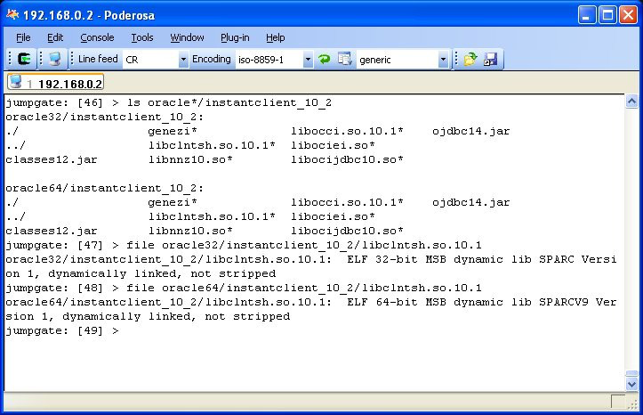

So we are all set to use both 32-bit and 64-bit Tcl binaries.

**NOTE** with Oracle instant client for Solaris, Oratcl always requires the ORACLE_LIBRARY environment variable to be set. And the instant client location has to be appended to the LD_LIBRARY_PATH environment variable before tclsh is started.

Figure 1 Solaris with 32 bit Oracle instant client (csh/tcsh) example

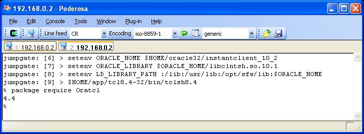

Figure 2 Solaris with 64 bit Oracle instant client (csh/tcsh) example

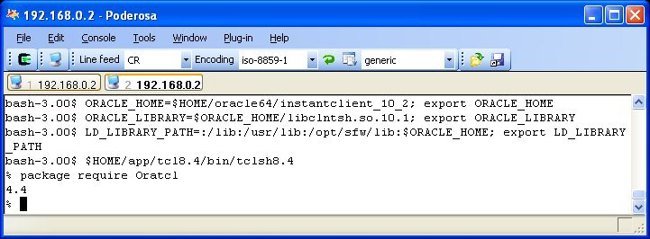

Once the package is able to load, then the Tcl interpreter is ready for the rest of the examples in this book. Before we depart the Solaris section, I think a few error conditions should be covered.

Figure 3 Solaris with 32 bit Oracle instant client (sh/bash) example

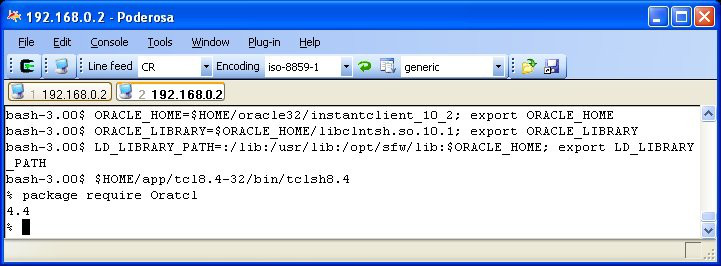

Figure 4 Solaris with 64 bit Oracle instant client (sh/bash) example


## RedHat Enterprise Linux 3, 4, 5

### Tcl rpm download and install for x86 linux

The installation of Oratcl on linux is quite possibly the easiest of all platforms. Unlike the Solaris OE or on Windows, Tcl is included in many Linux distributions. I’ve two test environments at my disposal and I regularly use both. In fact, my primary development platform is a Pentium based HP server running RedHat ES 5. Whether your server uses ‘yum’ or ‘up2date’, or if you are installing from a CD, there is very likely a tcl rpm available for an automatic install. To determine if you have tcl installed use the rpm query command

```
[oracle@dl320 ~]$ rpm -qa | grep tcl
tclx-8.4.0-5.fc6
tcl-8.4.13-3.fc6
```

On my server, tcl is already installed. Not a particularly new version by any means, but quite suitable for our purposes. If a newer version of Tcl is preferred, refer to the CVS checkout and compile methods in the Solaris section of this chapter. The steps to build from source code and install are identical in linux. If you are happy with the Tcl prebuilt for linux, then one of the many available rpm’s will suffice. For example, with the yum package maintenance utility: yum install tcl will do the trick, and when using up2date, up2date tcl will also work.

```
[oracle@dl320 ~]$ which tclsh
/usr/bin/tclsh
[oracle@dl320 ~]$ tclsh
% info patchlevel       
8.4.13
% package require Oratcl
can't find package Oratcl
% exit
```

### Oratcl rpm download and install for x86 linux

There are several download files available from the Oratcl project pages at http://oratcl.sourceforge.net. Included in the list of downloads is a preconfigured rpm for x86 linux.. Either browse on over to the project page in your favorite web browser, or use any http style download utility. The two commands below were all I needed for the installation.

```
wget http://downloads.sourceforge.net/oratcl/oratcl-4.4-1.i386.rpm
rpm –i oratcl-4-4-1.i386.rpm
```

A snapshot of the installation

```
 [root@dl320 oracle]# wget http://downloads.sourceforge.net/oratcl/oratcl-4.4-
1.i386.rpm
--16:49:16--  http://downloads.sourceforge.net/oratcl/oratcl-4.4-1.i386.rpm
Resolving downloads.sourceforge.net... 66.35.250.203
Connecting to downloads.sourceforge.net|66.35.250.203|:80... connected.
HTTP request sent, awaiting response... 302 Found
Location: http://superb-west.dl.sourceforge.net/sourceforge/oratcl/oratcl-4.4-
1.i386.rpm [following]
--16:49:16--  http://superb-west.dl.sourceforge.net/sourceforge/oratcl/oratcl-
4.4-1.i386.rpm
Resolving superb-west.dl.sourceforge.net... 209.160.59.253
Connecting to superb-west.dl.sourceforge.net|209.160.59.253|:80... connected.
HTTP request sent, awaiting response... 200 OK
Length: 37613 (37K) [application/x-redhat-package-manager]
Saving to: `oratcl-4.4-1.i386.rpm'
100%
[=============================================================================>] 
37,613       118K/s   in 0.3s   
16:49:17 (118 KB/s) - `oratcl-4.4-1.i386.rpm' saved [37613/37613]
[root@dl320 oracle]# 
[root@dl320 oracle]# rpm -i oratcl-4.4-1.i386.rpm
```

And now Oratcl is installed in /usr/lib/Oratcl4.4 and tclsh is able to locate it.

```
% package require Oratcl
4.4
```

### Oracle Instant Client for Linux Installation for x86 linux

### Tcl rpm download and install for x86-64 linux

### Oratcl rpm download and install for x86-64 linux

### Oracle Instant Client for Linux Installation for x86-64 linux

## Managing Oracle connections

### oralogon

In order for Oratcl to perform database operations, we must first connect to a database. Oratcl provides the oralogon command to Tcl. This command is used to establish connections to one or many oracle databases. The oralogon command will return a handle-string that will be used as a parameter to other Oratcl commands. The handle-string returned by oralogon is a unique value that will allow other the other commands to uniquely identify the memory structures created during a database connection. Through out this book and the example code, this return value will be referred to as the logon-handle. The login-handle is a string composed of the word “oratcl” concatenated with a numeric sequence. The first logon-handle returned after loading the library will be “oratcl0”, the next “oratcl1” etc. The syntax for the command is presented here.

```
oralogon connect-string \
?-sysdba? \
?-sysoper? \
?-sysasm? \
?-async? \
?-failovercallback procname?
```

The oralogon command always requires a connect-string parameter as the first argument.

#### local connections

Here is a simple example using a database running on the same server. The first step is to make sure that the required environment variables are set. For the local database connection, the connect-string is in the form of username/password.

```
[thelfter@dl320 ~]$ tclsh8.5
% set ::env(ORACLE_HOME) /u01/app/oracle/product/11.1.0/db_1
/u01/app/oracle/product/11.1.0/db_1
% set ::env(ORACLE_SID) orcl11g
orcl11g
% package require Oratcl
4.4
% oralogon scott/tiger
oratcl0
```

For a local database connection like the one shown above, the same environment variables that you would need to have set for Sql*Plus to work, are also required for Oratcl. Oratcl uses the same connection libraries as Sql*Plus. As show in the example, the logon-handle string returned is in the form of ‘oratcl’ concatenated with a unique digit, in this case a 0. So the logon-handle string is ‘oratcl0’

#### remote connections using local naming (TNSNAMES)

For a remote database connection, the connect string takes on a new form of username/password@connect_identifier. This type of connection requires fewer environment variables, as the

ORACLE_SID variable is no longer required to identify the target database. You may choose to utilize any of the Sql*Net provided network naming mechanisms.

```
ORCL11G =
  (DESCRIPTION =
    (ADDRESS = (PROTOCOL = TCP)(HOST = dl320)(PORT = 1521))
    (CONNECT_DATA =
      (SERVER = DEDICATED)
      (SERVICE_NAME = orcl11g)
    )
  )
ORCL10G =
  (DESCRIPTION =
    (ADDRESS = (PROTOCOL = TCP)(HOST = dl320)(PORT = 1522))
    (CONNECT_DATA =
      (SERVER = DEDICATED)
      (SERVICE_NAME = orcl10g)
    )
  )
```

This example shows how to use local naming (tnsnames.ora). The tnsnames.ora file used by the reference system is included below. Two entries are listed, one for a 11gR1 database and one for a 10gR2 database. Two database connections are made, one to each of the local database instances.

```
[thelfter@dl320 ~]$ tclsh8.5
% set ::env(ORACLE_HOME) /u01/app/oracle/product/11.1.0/db_1
/u01/app/oracle/product/11.1.0/db_1
% package require Oratcl
4.4
% oralogon scott/tiger@orcl11g 
oratcl0
% oralogon scott/tiger@orcl10g
oratcl1
```

As demonstrated by this example, one of the more useful features of Oratcl is the ability to connect to multiple databases simultaneously.

If local naming is not available, then you may specify the full Sql*Net name as part of the connect string.

```
[thelfter@dl320 chapter4]$ tclsh8.5
% set ::env(ORACLE_HOME) /u01/app/oracle/product/11.1.0/db_1
/u01/app/oracle/product/11.1.0/db_1
% package require Oratcl
4.4
% oralogon scott/tiger@(DESCRIPTION=(ADDRESS=(PROTOCOL=tcp)(HOST=dl320)
(PORT=1521))(CONNECT_DATA=(SERVICE_NAME=orcl11g)))
oratcl0
% oralogon scott/tiger@(DESCRIPTION=(ADDRESS=(PROTOCOL=tcp)(HOST=dl320)
(PORT=1522))(CONNECT_DATA=(SERVICE_NAME=orcl10g)))
oratcl2
```

Now is when a little Tcl scripting starts to really become useful. Trying to get connect strings like these formatted properly every time it is used can become an easy point of failure. A little helper function can be very useful at a time like this. Here is the last example again with a user defined procedure to help with the formatting.

Note : The rest of the examples in this chapter are presented in Tcl script format.

```
set ::env(ORACLE_HOME) /u01/app/oracle/product/11.1.0/db_1
package require Oratcl
proc build_connect_string {user pass proto host port service} {
set addr [format {ADDRESS=(PROTOCOL=%s)(host=%s)(port=%s)} \
$proto \
$host \
$port] 
set data [format {CONNECT_DATA=(SERVICE_NAME=%s)} $service]
set desc [format {(DESCRIPTION=(%s)(%s))} $addr $data]
set conn [format {%s/%s@%s} $user $pass $desc]
return $conn
} 
set cs1 [build_connect_string scott tiger tcp dl320 1521 orcl11g]
oralogon $cs1
set cs2 [build_connect_string scott tiger tcp dl320 1522 orcl10g]
oralogon $cs2
```

#### remote connections using Easy Connect

Starting with Oracle 10g and including the 10g Instant Client, Oracle introduced another way of connecting to a networked data source. A method that will at once feel easier to read and easier to code. Oracle refers to this method as an Easy Connect (URL) style service name and it is formatted as follows:

```
//host:[port][/service name]
```

Using the reference environment, these are valid Easy Connect (URL) style connect commands:

```
set ::env(ORACLE_HOME) /u01/app/oracle/product/11.1.0/db_1
package require Oratcl
oralogon scott/tiger@//dl320:1521/orcl11g
oralogon scott/tiger@//dl320:1522/orcl10g
```

#### SYSDBA, SYSOPER and SYSASM connections (Oratcl 4.5)

Using the latest version 4.5 of Oratcl, local or remote SYSDBA, SYSOPER or SYSASM connections have been implemented. These types of connections can be obtained with commands that use the one of the new command options –sysdba, -sysoper or –sysasm. It is important to note that SYSASM connections are only possible to an Oracle 11g ASM instance.

```
# sysdba connections
oralogon scott/tiger –sysdba
oralogon scott/tiger@orcl11g -sysdba
oralogon scott/tiger@//dl320:1521/orcl11g -sysdba
# sysoper connections
oralogon scott/tiger –sysoper
oralogon scott/tiger@orcl11g -sysoper
oralogon scott/tiger@//dl320:1521/orcl11g -sysoper
```

If you use more than one of these options, Oratcl will use the last one. The following command would result in a SYSDBA connection.

```
oralogon scott/tiger –sysdba –sysoper -sysdba
```

#### local SYSDBA and SYSOPER connections (Oratcl 4.1 -> Oratcl 4.4)

Using Oratcl versions 4.1 through 4.4, it is possible to obtain a SYSDBA or SYSOPER connection only to a locally running database.

```
[thelfter@dl320 ~]$ tclsh8.5
% set ::env(ORACLE_HOME) /u01/app/oracle/product/11.1.0/db_1
/u01/app/oracle/product/11.1.0/db_1
% set ::env(ORACLE_SID) orcl11g
orcl11g
% package require Oratcl
4.4
% oralogon sysdba
oratcl0
% oralogon sysoper
oratcl1
```

#### Additional options to oralogon

The optional -async argument specifies that all commands allowing asynchronous (nonblocking) operation will do so. The commands affected by this advanced option are the Oratcl DML primitives: oraparse, oraexec, orafetch and those macro functions that make use of the primitives such as orasql, orabindexec and oraplexec. See the chapter on Asynchronous Transaction Handling for more details as coding in the asynchronous mode requires a variety of script changes.

The optional -failovercallback procname arguments provide Transparent Applicaton Failover (TAF) functionality to Oratcl. The given procname is invoked automatically on a TAF failover event. It is often used to re-execute "alter session" statements after the automatic reconnect to another RAC node. Here is an example.

#### Error codes and handling.

Limitations:

It is not possible to say what the maximum number of connections to a particular database will be. The functional limit depends on the specific Oracle database. If establishing a dedicated server connection, the limit can be estimated by subtracting the number of existing processes from the processes init.ora parameter. For instance, if you have processes=500 in your init.ora (or spfile) and a relatively unused (no other users connected) database, then you can expect to be able to open about 485 connections. If operating with the shared server configuration, then thousands of connections are possible depending on the shared server configuration. Refer to the Oracle net services for additional information. In addition to these limits, if the user account has been assigned to a profile that limits connections, then that will also impact the total number of connections.

Behind the Scenes: What does oralogon do?

For those Tcl API programmers out there, the logon-handle string is a Tcl_HashEntry created with Tcl_CreateHashEntry(). A pointer to the Oratcl LogPtr structure is stored as the hash value. This allows the other Oratcl commands requiring access to the LogPtr structure an efficient way to access the data structure without passing large amounts of data through the Tcl command API..

While this is not an OCI programming manual. I do believe that a short listing of the various OCI API functions utilized by the oralogon command will be helpful. Since the source code is readily available, I will not be including the actual code. The Oracle API calls (in order) used by this function are:

```
OCIEnvCreate();
OCIHandleAlloc(…, OCI_HTYPE_ERROR, …);
OCIHandleAlloc(…, OCI_HTYPE_SERVER, …);
OCIHandleAlloc(…, OCI_HTYPE_SVCCTX, …);
OCIServerAttach()
OCIAttrSet()
OCIHandleAlloc(…, OCI_HTYPE_SESSION, …);
OCIAttrSet(…, OCI_ATTR_USERNAME, …);
OCIAttrSet(…, OCI_ATTR_PASSWORD, …);
OCISessionBegin()
if –failovercallback then 
  OCIAttrSet(…, OCI_ATTR_FOCBK, …);
if –async then 
  OCIAttrSet(…, OCI_ATTR_NONBLOCKING_MODE, …);
```

Historic information:

If you have been tasked with maintaining or even upgrading applications that use older versions of Oratcl (3.0 or older), you will see that the documentation and programs refer to a LDA. A logon-data-area (LDA) was a data structure provided by oracle in the OCI6 and OCI7 (maybe even older) API. It is very common to see Oratcl code referring to an lda variable such as in the following sample. In fact I still refer to the logon-handle return string as an lda in most of the automatic tests and in many of my programs as well.

```
set lda [oralogon scott/tiger]
```

There is nothing wrong with referring to the logon-string as an lda, as in the context of the Oratcl application, this is really only a variable name and it has enough historic contexts for others reading your code to understand what you mean.

### oralogoff

Once we have created oracle sessions, the next natural question is how are they closed. The oralogoff command provides the ability to disconnect the session identified by the logon-handle parameter. It has a very simple syntax.

```
oralogoff logon-handle
```

The logon-handle passed to the oralogoff command must have been previously created by the oralogon command. In addition to disconnecting the Oracle session, oralogoff performs the following functions:

- All uncommitted DML transactions are committed (for all statement-handles created with oraopen and this logon-handle).

- All statement-handles created with the oraopen command using the logon-handle are closed.

- All memory structures associated with the logon-handle and the now closed statement-handles is freed.

- The logon-handle string is removed from the internal Tcl hash causing all subsequent Oratcl commands to raise an error if the logon-handle string is used as a parameter.

A properly coded application will specifically close any sessions that it has opened when it is through with them, however when exiting the Tcl shell or closing the Tcl interpreter, Oratcl will automatically close all sessions with the same results as if the session were logged off manually.

The example for oralogoff is quite simple.

```
set lh [oralogon scott/tiger]
oralogoff $lh
```

Error codes and handling

The oralogoff command will return a number value return code. Unlike many other return code systems where a 1 is a success and a 0 is a failure, Oratcl return codes operate using OCI return values. The return code OCI_SUCCESS is equal to 0. Therefore a return code of 0 is a success.

Behind the Scenes: What does oralogoff do?

The Oracle API calls used by this function are:

```
OCISessionEnd();
OCIServerDetach();
```

## Managing Oracle transactions

### oracommit

```
oracommit logon-handle
```

In many database programs, it is helpful to allow for periodic commits. The purpose of the oracommit command it to issue a commit to the oracle database. When issued, the commit affects all DML performed by any statement-handle opened with the logon-handle. This is an important consideration to take into effect when writing programs using Oratcl. It is possible, even desirable to open multiple statement-handles using a single connection to the database, the concept is similar to having multiple cursors in a pl/sql procedure. The Oracle API calls that arrange for the commit operate on the logon-handle data structures and thus issue the commit (or rollback) to the entire connection.

Best practices. In the old days of Oracle, before the UNDO tablespace and auto expanding data files, it was common to run into the dreaded snapshot too old error. This error was typically encountered when the rollback segment assigned to the user’s session filled up. The Oracle database of today is much more forgiving in this area, but even so, it is best to have your applications perform a commit periodically. Just like programming in pl/sql, proper commit handling can have a serious impact on your application's performance. Committing every transaction immediately is likely a good step for OLTP applications, but for large data set loading and processing, committing too frequently will seriously impact database performance.

Error codes and handling.

An error will be raised if the logon-handle parameter is invalid.

Behind the Scenes: What does oracommit do?

The Oracle API call used by this function is:

```
OCITransCommit();
```

### oraroll

```
oraroll logon-handle
```

The alternative to committing a pending transaction is the rollback. Issuing the rollback will undo any DML transactions performed by any statement-handle opened with the logon-handle since the last time the logon-

handle was commited. Even DML statements issued with a statement-handle that has been closed with oraclose, will be rolled back.

Error codes and handling.

Again an error is raised if the logon-handle parameter is invalid.

Behind the Scenes: What does oraroll do?

The Oracle API call used by this function is:

```
OCITransRollback();
```

### oraautocom

```
oraautocom logon-handle boolean
```

There are times in applications, where data integrity is more important than performance, many OLTP applications are constructed in this way. When DML transactions are important enough to require instant committing, Oratcl has made this easy for you by providing an oraautocom command. This command has two parameters, a logon handle and a boolean. The command enables or disables the automatic commit of SQL manipulation statements using any statement-handle opened through the connection specified by logon-handle. The boolean parameter may be any value that Tcl will evaluate to boolean true (1, on, true) to enable automatic commit, or boolean false (0, off, false) to disable. After setting the new automatic commit status, oraautocom returns the new commit status (1 for on, 0 for off) for validation purposes. The automatic commit feature defaults to "off".

```
# turn on autocommit
oraautocom $lh 1
oraautocom $lh on
oraautocom $lh true
# turn off autocommit
oraautocom $lh 0
oraautocom $lh off
oraautocom $lh false
```

In function, all this command does is set or unset a flag that is used by the oraexec command. This flag sets an OCI level value that instructs the oracle database to perform a commit for the session after executing the command passed.

## Performing SQL Queries and DML Statements

Now that we have the basic fundamentals of package loading and establishing database connections out of the way, its now time to get to where the real action is, running those SQL queries and DML statements is what we are here for. Programmers of PL/Sql packages might notice some similarities between the procedures used here and those used in PL/Sql.

### Oratcl statement-handle

All DML and SQL operations are performed in Oratcl using a statement-handle parameter. A statement- handle in Oratcl is the glue between Tcl and an Oracle OCI handle.

Before detailing each command individually, lets start with a small example. Using the sample schema loaded into the scott/tiger oracle account. Here is a sample script to insert a row into the EMP table of the scott/tiger sample schema.

```
package require Oratcl
set lh [oralogon scott/tiger]
set sh [oraopen $lh]
set sql {insert into emp (empno, ename, job, mgr, sal, deptno) \
values (8000,'WELLS','VP', 7439, 4000, 10)}
oraparse $sh $sql
oraexec $sh
oracommit $lh
oraclose $sh
oralogoff $lh
```

### oraopen

```
oraopen logon-handle
```

The purpose of oraopen is to create a statement-handle. The oraopen command returns a handle string to be used with subsequent Oratcl commands that require a statement-handle parameter. The logon-handle parameter must be a valid login-handle previously obtained from oralogon. It is possible and even desirable to open multiple statement handles using a single logon-handle. The oraopen command raises a Tcl error if the logon-handle specified is not valid.

#### statement-handle limits

The limit to the number of simultaneous open statement-handles is determined per connection by the Oracle database configuration, the init.ora parameter open_cursors determines the actual limit to the statement-handle count.

Behind the Scenes: What does oraopen do?

The Oracle API call used by this function is:

```
OCIHandleAlloc(…, OCI_HTYPE_STMT, …);
```

### oraclose

```
oraclose statement-handle
```

Close the specified statement-handle and free any memory segments linked to it. The oraclose command raises a Tcl error if the statement-handle specified is not open. Now that we can open and close statement- handles, we can move on towards using them to perform SQL queries which will take the form of:

Behind the Scenes: What does oraclose do?

The Oracle API call used by this function is:

```
OCIHandleFree();
```

Now that we can open and close statement-handles, we can move on towards using them to perform SQL queries which will take the form of:

```
oraparse 
Send the SQL statement to the database to be parsed
Determine the columns being selected 
orabind
optional step:
links data values from Tcl to placeholders in the SQL statement
oraexec
send the SQL statement to the database for execution
orafetch
obtain the result set from the database
```

A DML statement will follow a similar course, only omitting the orafetch, as there will not be return data for an INSERT, UPDATE, DELETE statement.

```
oraparse
Send the SQL statement to the database to be parsed
Determine the columns being selected 
orabind
optionally step:
link data values stored in Tcl to placeholders in the SQL statement
oraexec
send the SQL query to the database for execution
```

Similarly an anonymous PL/SQL statement uses the same commands

```
oraparse 
Send the PL/SQL statement to the database to be parsed
Determine the pl/sql parameters 
orabind
optional step:
links data values from Tcl to placeholders in the PL/SQL statement
oraexec
send the PL/SQL statement to the database for execution
orafetch
obtain the OUT parameters returned by the PL/SQL from the database
```

### oraparse

```
oraparse statement-handle statement-text
```

Send the SQL statement statement-text to the Oracle server for decomposition. The statement-text can be either a SQL or anonymous PL/SQL statement. There are a great many Oracle API calls made by this command especially for SELECT sql commands. The statement-text may contain bind variable placeholders that begin with a colon ':' character that orabind will use later for value substitution.

Examples:

```
oraparse $sh {select sysdate from dual}
oraparse $sh {delete from scott.emp where ename = ‘WELLS’}
oraparse $sh {delete from scott.emp where ename = :ename}
oraparse $sh {declare time number; begin :time := dbms_utility.get_time; end;}
```

Error conditions:

The statement-handle must be a valid handle previously opened with oraopen.

Return codes:

The oraparse command returns the numeric return code for OCI_SUCCESS a 0 on successful parsing of the statement-text, and the error code returned by the Oracle API when parsing fails. Oraparse raises a Tcl error if the statement-handle specified is not open, or if the statement-text is syntactically incorrect.

Behind the Scenes: What does oraparse do?

The Oracle API calls used by this function are:

```
OCIStmtPrepare();
OCIAttrGet(…, OCI_ATTR_STMT_TYPE, );
if (SELECT) then
  OCIStmtExecute(…,OCI_DESCRIBE_ONLY);
  if (ERROR) then
    OCIAttrGet(…, OCI_ATTR_PARSE_ERROR_OFFSET, …);
  OCIAttrGet(…, OCI_ATTR_SQLFNCODE, …);
  OCIAttrGet(…, OCI_ATTR_PARAM_COUNT, …);
  foreach parameter loop
    OCIParamGet();
    OCIAttrGet(… , OCI_ATTR_NAME, …);
    OCIAttrGet(…, OCI_ATTR_DATA_SIZE, …);
    OCIAttrGet(…, OCI_ATTR_DATA_TYPE, …);
    OCIAttrGet(…, OCI_ATTR_PRECISION, …);
    OCIAttrGet(…, OCI_ATTR_IS_NULL, …);
    if (NAMED TYPE) then
      OCIAttrGet(…, OCI_ATTR_TYPE_NAME, …);
  end loop;
end if (SELECT)
```

### orabind

```
orabind statement-handle ?:varname value ...?
```

The orabind command is used to link Tcl strings to SQL variables in a previously parsed SQL statement. This is done for efficiency so that Oracle can parse the SQL statement once and then use it multiple times to perform similar actions. Orabind may be executed repeatedly on a previously parsed statement. Binding should only be done in conjunction with sql types (1-4, 16) select, insert, update, delete, merge and with the PL/SQL types (8-9) begin and declare statements. Optional :varname value pairs allow substitutions on SQL bind variables. There should be the same number of :varname value pairs as there are defined in the previously parsed SQL statement.

Example:

```
set sql {insert into scott.emp(empno, ename) values(:empno, :ename)}
oraparse $cur $sql
orabind $cur :empno 1234 :name {Todd Helfter}
oraexec $cur
```

Error conditions:

- The statement-handle must have been opened with oraopen.
- An SQL or PL/SQL statement must have been previously parsed by the oraparse command using the same statement-handle.
- The binding placeholders must be prefixed by a colon ":".
- It is not an error to call orabind without any :varname value pairs, but no binding will occur.

Orabind return codes:

- 0 All bindings are successful.
- 1003 Binding placeholders do not match the parsed SQL or the SQL statement has not been parsed.
- 1008 Not all SQL bind variables have been specified.
- Refer to Oracle error numbers and messages for other possible values.

Using SQL bind variables is more efficient than letting Oracle reparse SQL statements. Use a combination of oraparse / orabind / oraexec for maximum efficiency:

```
set sql {insert into scott.emp(empno, ename) values(:empno, :ename)}
oraparse $cur $sql
foreach numb [list 1235 1236 1237 1238] name [list Ted Alice John Sue] {
  orabind $cur :empno $numb :ename $name
  oraexec $cur
}
```

2447 microseconds per iteration

Is faster and incurs less load on the database than:

```
foreach numb [list 1235 1236 1237 1238] name [list Ted Alice John Sue] {
  set sql "insert into scott.emp(empno, ename) values ($numb, '$name')"
  oraparse $cur $sql
  oraexec $cur
}
```

3475 microseconds per iteration

Behind the Scenes: What does orabind do?

The Oracle API calls used by this function are performed for each bind field:

```
if (string data) then
  if (unicode) then
    OCIBindByName();
    OCIAttrSet(…, OCI_ATTR_CHARSET_ID, );
    OCIAttrSet(…, OCI_ATTR_MAXDATA_SIZE, );
  else
    OCIBindByName();
    if (arraydml) then
      OCIBindDynamic)
    endif
else
  if (refcursor data) then
    OCIBindByName(…, SQLT_RSET, …);
  endif
endif
```

AUTHORS NOTE: In my own applications, I always use bind variables for every SQL statement, even those that are executed only once. Here are some reasons why:

- orabind removes the burden of escaping the single quote characters in your character data.
- orabind reduces the number of SQL statements in the Oracle parse cache keeping other statements in the cache from being swapped out.
- orabind provides the database and the DBA a single SQL statement for purposes of tuning and execution path analysis

### oraexec

```
oraexec statement-handle ?-commit?
```

Execute a previously parsed and optionally bound SQL statement. Statement-handle must be a valid handle previously opened with oraopen. An SQL statement must have previously been parsed by the oraparse command. Orabind and oraexec commands may be repeatedly issued after a statement is parsed.

The optional -commit argument specifies that the SQL will be committed upon successful execution.

### orafetch

```
orafetch statement-handle ?options ...?
```

The orafetch command is used to retrieve data from the database as specified by a prior sequence of oraparse, orabind and oraxec commands. As previously mentioned, Tcl has only one data type, a string, so all returned values are converted to character strings except for ref_cursors which will be represented in a datavariable list as a null string. The orafetch commands returns the result from the OCIStmtExecute() OCI function. Likely values include 0 for success, 1404 for no more data, and -3123 for asyncronous still executing.

The following options can also be specified.

- -datavariable Specifies the variable to be set with a list containing the row of data fetched. The list returned in the datavariable by orafetch contains the values of the selected columns in the order specified by select.

- -dataarray Specifies the array in which the individual columns of data fetched will be set.

- -indexbyname When combinded with the -dataarray option, orafetch will use the column names from the query as the index (hash) values of the array.

- -indexbynumber When combinded with the -dataarray option, orafetch will use the column positon number from the query as the index (hash) values of the array.

- -command Specifies a script to eval when orafetch retrieves a row of data. This script may reference the variable and array specified by other options.

Orafetch raises a Tcl error if the statement-handle specified is not open, or if an unknown option is specified.

## Altering Oratcl’s default behavior

### oraconfig

```
oraconfig statement-handle
oraconfig statement-handle ?option-name?
oraconfig statement-handle ?option-name ?option-value?
```

The oraconfig command is used to get or set various behaviors of Oratcl at the statement-handle level. If no arguments are provided as shown in the first sample syntax, the oraconfig command creates a return value composed of a list of all option-name and option-value pairs. If only an option-name is specified such as in the second syntax line above, the associated option-value will be returned. When both option-name and option- value are provided, oraconfig will set the option-name to the provided option-value.

Before explaining each of these options individually, here are all the options and a brief description.

Option Description

bindsize The size of the reusable buffer created for each bind column by orabind, orabindexec and oraplexec for storing bind variable values. The default is 4000 bytes and the maximum is 214744647 bytes.

datesize Sets or returns the amount of data (in characters) used to represent a date column. Datesize defaults to 75 characters and the maximum is 7500 characters.

fetchrow s

Configure the number of rows fetched and cached by orafetch. The orafetch command will bulk fetch ‘fetchrows’ rows from the Oracle server with a single network round iteration. Fetchrows defaults to 10 rows and the maximum is dependent upon available memory.

lobpsize The amount of data (in characters) used in piecewise reads and writes to LOB types with the oralob command. The default is 10,000 characters and the maximum is 214744647 characters

longpsiz e

Sets or returns the amount of data (in characters) used in piecewise reads and writes to LONG types in the oralong command. Longpsize defaults to 50,000 characters and the maximum is 2,147,4.4,648 characters.

longsize The maximum amount of LONG or LONG RAW data returned by orafetch for each column of that type. The default is 40960 bytes and the maximum is 214744647 bytes.

nullvalue Manage the NULL value substitution behavior. A value of "default" causes orafetch to substitute zeros for NULLs in numeric columns and null strings "{}" for NULLs in character columns. Any other value causes that value to be returned as a string for all NULLs. The default is "default".

numbsiz e

Sets or returns the amount of data (in characters) used to represent a number column. Numbsize defaults to 40 characters and the maximum is 4000 characters.

utfmode Sets or returns the UTF translation behavior. Setting this value to true causes orasql, orabindexec, oraplexec, orafetch, oralong and oralob to perform UTF translation on values written to and read

from the database with the system encoding. It is not recommended that this function be enabled when reading or writing long raw type values with oralong. The default is false.

Error conditions. For numeric values, a value less than or equal to zero or greater than the stated maximum will cause Oratcl to raise a TCL error.

- Setting the fetchrows to larger numbers for queries that return many rows may dramatically decrease the time spent fetching the rows. Changes to fetchrows only affects subsequent oratcl commands.

## Oracle DATE types

### Querying Date Fields

Tcl handles all data as strings and lists. Oracle has very particular patterns to use with date literals in SQL. On queries, date literals will be converted to Tcl strings using the date format in effect at the time of the query. For insert and update statements, Tcl strings will be converted to date literals using the date format in effect at the time. Of course in both cases, the user can override any default behaviors with the TO_CHAR and TO_DATE Oracle functions. What follows are a series of examples that show what behaviors you can expect in the handling of date colums.

Example 1: Default date format DD-MON-YY

```
oraparse $cur {select empno, hiredate from emp where deptno=10}
oraexec $cur
while {[orafetch $cur -datavariable row] == 0} { puts $row }
8000 16-DEC-07
7782 09-JUN-81
7839 17-NOV-81
7934 23-JAN-82
```

Example 2 : Change returned date format using ‘alter session’ SQL.

```
# Use alter session to change returned date strings
oraparse $cur {alter session set nls_date_format='DD-MON-YYYY HH24:MI:SS’}
oraexec $cur
oraparse $cur {select empno, hiredate from emp where deptno=10}
oraexec $cur
while {[orafetch $cur -datavariable row] == 0} { puts $row }
8000 {16-DEC-2007 05:30:00}
7782 {09-JUN-1981 00:00:00}
7839 {17-NOV-1981 00:00:00}
7934 {23-JAN-1982 00:00:00}
```

Example 3: Change returned date format using the to_char function.

```
oraparse $cur { \
  select empno, to_char(hiredate,'DD-MON-YYYY HH24:MI:SS') from emp where deptno=10 \
}
oraexec $cur
while {[orafetch $cur -datavariable row] == 0} { puts $row } 
8000 {16-DEC-2007 05:30:00}
7782 {09-JUN-1981 00:00:00}
7839 {17-NOV-1981 00:00:00}
7934 {23-JAN-1982 00:00:00}
```

Example 4: Change returned date languages using ‘alter session’.

```
oraparse $cur {alter session set nls_date_format='Day : Month : YYYY HH:MI:SS am'}
oraexec $cur
oraparse $cur {alter session set nls_date_language='spanish'}
oraexec $cur
oraparse $cur {select empno, hiredate from emp where deptno=10}
oraexec $cur
while {[orafetch $cur -datavariable row] == 0} { puts $row }
8000 {Miercoles : Diciembre  : 2007 08:15:00 AM}
7782 {Martes    : Junio      : 1981 12:00:00 AM}
7839 {Martes    : Noviembre  : 1981 12:00:00 AM}
7934 {Sabado    : Enero      : 1982 12:00:00 AM}
```

### Inserting and Updating Date Fields

Example 5: Update a date field using the default database format.

```
oraparse $cur { \
  update scott.emp \
  set hiredate='17-DEC-07' \
  where empno = '8000'
}
oraexec $cur
oracommit $lda
oraparse $cur { \
  select empno, to_char(hiredate,'DD-MON-YYYY HH24:MI:SS') \
  from emp where empno=8000 \
}
oraexec $cur
while {[orafetch $cur -datavariable row] == 0} { puts $row }
8000 17-DEC-07
```

Example 6: Use alter session to change the date format.

```
oraparse $cur {alter session set nls_date_format='DD-MON-YYYY HH24:MI:SS'}
oraexec $cur
oraparse $cur { \
  update scott.emp \
  set hiredate='18-DEC-07 08:00:00' \
  where empno = '8000'
}
oraexec $cur
oracommit $lda
oraparse $cur { \
  select empno, hiredate from emp where empno=8000 \
}
oraexec $cur
while {[orafetch $cur -datavariable row] == 0} { puts $row }
8000 {18-DEC-0007 08:00:00}
```

Example 7: Use Oracle to_date function to convert strings to dates.

```
oraparse $cur { \
  update scott.emp \
  set hiredate=to_date('19-DEC-2007 8:15:00', 'DD-MON-YYYY HH24:MI:SS') \
  where empno = '8000'
}
oraexec $cur
oracommit $lda
oraparse $cur { \
  select empno, to_char(hiredate,'DD-MON-YYYY HH24:MI:SS') \
  from emp where empno=8000 \
}
oraexec $cur
while {[orafetch $cur -datavariable row] == 0} { puts $row }
8000 {19-DEC-2007 08:15:00}
```

## PL/SQL stored procedures

Similar to Oratcl’s handling of DML and SELECT statements, Oratcl can also submit PL/SQL statements to the database for execution. These statements must take the form of an ANONYMOUS PL/SQL statement. That is, they must begin with either a DECLARE or a BEGIN and they also must have a trailing END; The trailing semi colon is required. The handling of PL/SQL statements is performed with the same steps as a SELECT. First the statement is parsed with oraparse. Then optional parameters are bound to the statement with orabind. Finally the statement is executed with oraexec. Parameters substituted by the Oracle database are retrieved with a single call to orafetch. A properly formatted PL/SQL procedure invocation would look like this.

```
set plsql {BEGIN my_procedure(); END;}
oraparse $stm $plsql
oraexec $stm
orafetch $stm –datavariable res
```

Since that is such a simple example, let me give one that is more complex. Again we will make use of the EMP schema that Oracle provides. Using the following PL/SQL package we can perform a number of operations on that package from TCL. The package has both a procedure and a function so that using both can be demonstrated.

```
CREATE OR REPLACE PACKAGE oratcl_emp_8 AS
        procedure get_name (p_empno in emp.empno%type, p_ename out emp.ename%type);
        function max_sal return emp.sal%type;
END;
CREATE OR REPLACE PACKAGE BODY oratcl_emp_8 AS
        procedure get_name (p_empno in emp.empno%type, p_ename out emp.ename%type) is
        begin
                select ename into p_ename from emp
                where emp.empno = p_empno;
        end;
        function max_sal return emp.sal%type is
                res     number; 
        begin
                select max(sal) into res from emp;
                return res;
        end max_sal;
END;
```

In the very first example, my_procedure() has no parameters, so a call to orabind is not required. However the oratcl_emp_8 package does have parameters for the procedure and a return value from the function. The PL/SQL stored procedures may use IN, OUT and/or IN OUT parameters.

So first, let’s use the get_name procedure of the oratcl_emp_8 PL/SQL package. It has two parameters, the empno (an IN parameter) and ename (an OUT parameter).

```
#
# example8_1.tcl
#
package require Oratcl
set lda [oralogon scott/tiger]
set cur1 [oraopen $lda]
oraparse $cur1 {begin oratcl_emp_8.get_name(:empno, :ename); end;}
orabind $cur1 :empno 8000 :ename {}
oraexec $cur1
while {[orafetch $cur1 -datavariable row] == 0} {
        puts $row
        puts "Name = [lindex $row 1]"
}
oraclose $cur1
oralogoff $lda
[thelfter@dl320 chapter8]$ tclsh example8_1.tcl 
8000 HELFTER
Name = HELFTER
```

As mentioned previously, orafetch with the –datavariable option is used to obtain the parameter values returned by the Oracle database. The parameters are returned as a TCL list, in exactly the same order that they are bound with the orabind command. Thus changing the above example to:

```
#
# example8_2.tcl
#
package require Oratcl
set lda [oralogon scott/tiger]
set cur1 [oraopen $lda]
oraparse $cur1 {begin oratcl_emp_8.get_name(:empno, :ename); end;}
orabind $cur1 :ename {} :empno 8000
oraexec $cur1
while {[orafetch $cur1 -datavariable row] == 0} {
        puts $row
        puts "Name = [lindex $row 1]"
}
oraclose $cur1
oralogoff $lda
```

Is still accurate, but changes the return parameter list to something that is very likely to be different from the programmer’s intention.

```
[thelfter@dl320 chapter8]$ tclsh example8_2.tcl 
HELFTER 8000
Name = 8000
```

It is the responsibility of the application programmer, to pull the parameter values back out of the TCL list at the proper list index. Remember that TCL list indexes begin with position 0.

Once a statement handle has been parsed, that handle can be reused multiple times. In the following example, oraparse is invoked only once, but orabind, oraexec, and orafetch may be re-issued with the same or different values for as long as the statement handle is not reparsed or closed.

```
#
# example8_3.tcl
#
package require Oratcl
set lda [oralogon scott/tiger]
set cur1 [oraopen $lda]
oraparse $cur1 {begin oratcl_emp_8.get_name(:empno, :ename); end;}
orabind $cur1 :empno 8000 :ename {}
oraexec $cur1
while {[orafetch $cur1 -datavariable row] == 0} {
        puts "Name = [lindex $row 1]"
}
orabind $cur1 :empno 7369 :ename {}
oraexec $cur1
while {[orafetch $cur1 -datavariable row] == 0} {
        puts "Name = [lindex $row 1]"
}
orabind $cur1 :empno 7499 :ename {}
oraexec $cur1
while {[orafetch $cur1 -datavariable row] == 0} {
        puts "Name = [lindex $row 1]"
}
oraclose $cur1
oralogoff $lda
[thelfter@dl320 chapter8]$ tclsh example8_3.tcl 
Name = HELFTER
Name = SMITH
Name = ALLEN:
```

‘

For PL/SQL functions, the code is much the same. In fact, only the PL/SQL statement itself takes a slightly different form to take into account the return value.

```
#
# example8_4.tcl
#
package require Oratcl
set lda [oralogon scott/tiger]
set cur1 [oraopen $lda]
oraparse $cur1 {begin :sal := oratcl_emp_8.max_sal(); end;}
orabind $cur1 :sal {}
oraexec $cur1
while {[orafetch $cur1 -datavariable row] == 0} {
        puts $row
        puts "sal = [lindex $row 0]"
}
oraclose $cur1
oralogoff $lda
[thelfter@dl320 chapter8]$ tclsh example8_4.tcl
5000
sal = 5000
```

## PL/SQL REF CURSOR variables

A REF CURSOSR is a data type in the PL/SQL language. It is a representation of a result set., as opposed to a static value. In Oratcl, a REF CURSOR variable may be bound to a statement handle and the orafetch command can be used to obtain the results. Sounds complicated, but it is really quite easy. Let’s start with an example.

First we need a little PL/SQL package (I prefer packages, but a procedure or function would work as well).

```
CREATE OR REPLACE PACKAGE oratcl_emp_9 AS
        TYPE CurType IS REF CURSOR RETURN emp%ROWTYPE;
        PROCEDURE select_emp (ref_cur OUT CurType);
END;
CREATE OR REPLACE PACKAGE BODY oratcl_emp_9 AS
        PROCEDURE select_emp (ref_cur OUT CurType) IS
        BEGIN
                OPEN ref_cur FOR SELECT * FROM emp;
        END select_emp;
END;
```

And a sample Oratcl script to use the package.

```
package require Oratcl
set lda [oralogon scott/tiger]
set cur1 [oraopen $lda]
set cur2 [oraopen $lda]
oraparse $cur1 {begin oratcl_emp_9.select_emp(:res); end;}
orabind $cur1 :res $cur2
oraexec $cur1
while {[orafetch $cur2 -datavariable row] == 0} {
        puts $row
}
oraclose $cur1
oraclose $cur2
oralogoff $lda
```

Note that two statement handles are required to make use of REF CURSOR variables. One for Oratcl to parse and execute the PL/SQL command, and another for Oratcl to fetch the REF CURSOR result sets. For this to work, the 2nd statement handle has to be bound to the pl/sql parameter with orabind. Both statement handles may be re-used for other operations.

```
[thelfter@dl320 chapter9]$ tclsh example9_1.tcl 
8000 HELFTER VP 7439 19-DEC-07 5000 0 10
7369 SMITH CLERK 7902 17-DEC-80 800 0 20
7499 ALLEN SALESMAN 7698 20-FEB-81 1600 300 30
7521 WARD SALESMAN 7698 22-FEB-81 1250 500 30
7566 JONES MANAGER 7839 02-APR-81 2975 0 20
7654 MARTIN SALESMAN 7698 28-SEP-81 1250 1400 30
7698 BLAKE MANAGER 7839 01-MAY-81 2850 0 30
7782 CLARK MANAGER 7839 09-JUN-81 2450 0 10
7788 SCOTT ANALYST 7566 19-APR-87 3000 0 20
7839 KING PRESIDENT 0 17-NOV-81 5000 0 10
7844 TURNER SALESMAN 7698 08-SEP-81 1500 0 30
7876 ADAMS CLERK 7788 23-MAY-87 1100 0 20
7900 JAMES CLERK 7698 03-DEC-81 950 0 30
7902 FORD ANALYST 7566 03-DEC-81 3000 0 20
7934 MILLER CLERK 7782 23-JAN-82 1300 0 10
```

Utilizing REF CURSOR PL/SQL variables, it is possible for the code developer to place all of the DML and select statements used in an application in one or more PL/SQL packages. This method keeps control of the data and return values at the database level and allows the end user application to remain highly generic.

Using the oracols command on the REF CURSOR result after execution, it is possible to obtain the name, type and precision of each of the columns in the result set.

```
package require Oratcl
set lda [oralogon scott/tiger]
set cur1 [oraopen $lda]
set cur2 [oraopen $lda]
oraparse $cur1 {begin oratcl_emp_9.select_emp(:res); end;}
orabind $cur1 :res $cur2
oraexec $cur1
foreach col [oracols $cur2 all] {
        puts $col
}
oraclose $cur1
oraclose $cur2
oralogoff $lda
```

You will find out in the next chapter that oracols returns a list of lists. One element of the list represents each column, and that element contains the column name, size, type, precision, scale and nullok (if the column is defined as not null, then nullok is 0 otherwise it is 1).

```
[thelfter@dl320 chapter9]$ tclsh example9_2.tcl 
EMPNO 22 NUMBER 4 0 0
ENAME 10 VARCHAR2 {} {} 1
JOB 9 VARCHAR2 {} {} 1
MGR 22 NUMBER 4 0 1
HIREDATE 7 DATE {} {} 1
SAL 22 NUMBER 7 2 1
COMM 22 NUMBER 7 2 1
DEPTNO 22 NUMBER 2 0 1 
```

## Oracle Error Handling and Introspection

Oratcl provides several commands that allow you to obtaining meta-data information from the Oracle database. These commands include the ability to display error information, desc tables, views and synonyms, describe column data for currently executing SQL and to obtain a list of logon handles and statement handles. First among these is error handling

### oramsg

```
oramsg  statement-handle ?option?
```

The oramsg command is used to obtain status and error information from the Oracle database.

```
oramsg  statement-handle rows
```

The first and most common use case for the oramsg command is to obtain the row count during a fetch operation. From a programmer’s perspective, it can be very important to know what the current row number is. The rows option will return the number of rows affected by an INSERT, UPDATE, or DELETE statement as well.

```
#
# example10_1.tcl
#
package require Oratcl
set lda [oralogon scott/tiger]
set cur1 [oraopen $lda]
oraparse $cur1 {select ename from emp}
oraexec $cur1
while {[orafetch $cur1 -datavariable ename] == 0} {
        puts "row( [oramsg $cur1 rows] ) = $ename"
}
oraclose $cur1
oralogoff $lda
[thelfter@dl320 chapter10]$ tclsh8.6 example10_1.tcl 
row( 1 ) = HELFTER
row( 2 ) = SMITH
row( 3 ) = ALLEN
row( 4 ) = WARD
row( 5 ) = JONES
row( 6 ) = MARTIN
row( 7 ) = BLAKE
row( 8 ) = CLARK
row( 9 ) = SCOTT
row( 10 ) = KING
row( 11 ) = TURNER
row( 12 ) = ADAMS
row( 13 ) = JAMES
row( 14 ) = FORD
row( 15 ) = MILLER
```

In the earlier versions of Oratcl, (version 2.X and 3.X), the row number result was stored in an oramsg global hash (array). This was changed in Oratcl 4.X to a command based on a statement handle so that Oratcl could function in conjunction with the thread package to create multithreaded applications.

```
oramsg  statement-handle sqltype
```

The next use for the oramsg command, is to provide the type of SQL statement being executed. Oracle’s OCI library classifies each SQL statement type with a type code. The sqltype parameter causes oramsg to return the code set by the last SQL or PL/SQL to be parsed with oraparse. Valid values are:

```
1
SELECT
corresponds to OCI_STMT_SELECT
2
UPDATE
corresponds to OCI_STMT_UPDATE
3
DELETE
corresponds to OCI_STMT_DELETE
4
INSERT
corresponds to OCI_STMT_INSERT
5
CREATE
corresponds to OCI_STMT_CREATE
6
DROP
corresponds to OCI_STMT_DROP
7
ALTER
corresponds to OCI_STMT_ALTER
8
BEGIN
corresponds to OCI_STMT_BEGIN
9
DECLARE
corresponds to OCI_STMT_DECLARE
16
MERGE
corresponds to OCI_STMT_MERGE
```

Here is an example program, demonstrating the use of the sqltype parameter.

```
#
# example10_2.tcl
#
package require Oratcl
proc get_sqltype {sqltype} {
        switch $sqltype {
                1 { return SELECT }
                2 { return UPDATE }
                3 { return DELETE }
                4 { return INSERT }
                5 { return CREATE }
                6 { return DROP }
                7 { return ALTER }
                8 { return BEGIN }
                9 { return DECLARE }
                16 { return MERGE }
        }
}
set lda [oralogon scott/tiger]
set cur1 [oraopen $lda]
set sql {select ename from emp}
oraparse $cur1 $sql
set sqltype [oramsg $cur1 sqltype]
puts "$sqltype [get_sqltype $sqltype] is \"$sql\""
set sql  {drop table emp}
oraparse $cur1 $sql
set sqltype [oramsg $cur1 sqltype]
puts "$sqltype [get_sqltype $sqltype] is \"$sql\""
oraclose $cur1
oralogoff $lda
[thelfter@dl320 chapter10]$ tclsh8.6 example10_2.tcl 
1 SELECT is "select ename from emp"
6 DROP is "drop table emp
oramsg  statement-handle rc
oramsg  statement-handle error
oramsg  statement-handle peo
```

There are three parameters to the oramsg command that are designed to be used in combination. These are rc, error, and peo. The rc parameter, or return code, causes oramsg to return the rc value from the last executed command. The rc value comes from the Oracle database. The error, or error string, returns the corresponding full error text from the database. And the peo, or parse error offset, returns the position in the error string where the error occurs.

```
#
# example10_3.tcl
#
package require Oratcl
set lda [oralogon scott/tiger]
set cur1 [oraopen $lda]
set sql {select a,b,c from emp}
catch {oraparse $cur1 $sql}
puts "rc = [oramsg $cur1 rc]"
puts "error = [oramsg $cur1 error]"
puts "peo = [oramsg $cur1 peo]"
puts {}
puts $sql
puts [string repeat { } [oramsg $cur1 peo]]^
oraclose $cur1
oralogoff $lda
[thelfter@dl320 chapter10]$ tclsh8.6 example10_3.tcl 
rc = 904
error = {ORA-00904: "C": invalid identifier}
peo = 11
select a,b,c from emp
           ^
```

There are many values that Oracle may return as a return code that do not have an error text associated with them. That is because these are return codes that are not errors, but status codes. Some examples are:

```
0
Function completed normally
```

144 Fetch results exhausted. End of data in orafetch command

1406 Fetched column was truncated.

-3123 Asynchronous command still processing

I will cover the use of the asynchronous return code more completely in a chapter devoted to that topic.

```
oramsg  statement-handle ocicode
```

The oramsg parameter ocicode, is used to obtain the OCI_ATTR_SQLFNCODE attribute from a statement handle after it is executed. Before the statement handle is executed with oraexec, this value has no meaning. I’ve never actually used this function for anything. I’m not even sure why I implemented it. Time to check the Oracle OCI documentation for it’s real purpose. Oh yeah, it is an even more fine grained description of the SQL statement. A careful review of the code shows that this functionality is completely broken. This is now fixed in version 4.5 and back ported in CVS to version 4.4

There are almost 200 possible return values for this attribute. I recommend the Oracle documentation for a complete list:

http://download.oracle.com/docs/cd/B19306_01/appdev.102/b14250/ociaahan.htm#sthref6013

```
#
# example10_4.tcl
#
package require Oratcl
proc get_sqlfncode {fncode} {
        switch $fncode {
                4 { return SELECT }
                9 { return DELETE }
                52 { return {ALTER SESSION} }
        }
}
set lda [oralogon scott/tiger]
set cur1 [oraopen $lda]
set sql {select ename from emp}
oraparse $cur1 $sql
oraexec $cur1
set ocicode [oramsg $cur1 ocicode]
puts "$ocicode [get_sqlfncode $ocicode] is \"$sql\""
set sql  {alter session set NLS_DATE_FORMAT='YYYY-MON-DD HH24:MI:SS'}
oraparse $cur1 $sql
oraexec $cur1
set ocicode [oramsg $cur1 ocicode]
puts "$ocicode [get_sqlfncode $ocicode] is \"$sql\""
set sql  {delete from emp where empno=9999}
oraparse $cur1 $sql
oraexec $cur1
set ocicode [oramsg $cur1 ocicode]
puts "$ocicode [get_sqlfncode $ocicode] is \"$sql\""
oraclose $cur1
oralogoff $lda
[thelfter@dl320 chapter10]$ tclsh8.6 example10_4.tcl 
4 SELECT is "select ename from emp"
52 ALTER SESSION is "alter session set NLS_DATE_FORMAT='YYYY-MON-DD 
HH24:MI:SS'"
9 DELETE is "delete from emp where empno=9999"
oramsg  statement-handle arraydml
```

A recent addition to Oratcl in version 4.5 is the ability to perform bulk inserts and updates. This feature called arrraydml has an associated oramsg parameter to assist with the status and error handling of arraydml commands.

```
oramsg  statement-handle all
```

Invoking oramsg with the all parameter has oramsg return all values as a list of values in the following order: rc, error, rows, peo, ocicode, sqltype, arraydml. With this feature, a programmer can call oramsg once and use lindex to pull out the particular values of interest. This can be more efficient than invoking oramsg multiple times (see example10_3.tcl). The time saving is marginal in either case.

Oramsg raises a TCL error if the statement-handle is invalid.

```
[thelfter@dl320 chapter10]$ tclsh8.6
% package require Oratcl
% oramsg oratc0.0 rc
oramsg: handle oratc0.0 not valid
```

### oradesc

```
oradesc logon-handle table-name
```

Describes the columns of table-name. Returns a list containing lists in the format {name size type precision scale nullok} for each column of the table. Oradesc will also describe the columns of a table refer enced by a private or public synonym when given the name of a synonym as the table-name argument. Oradesc will describe an object in the connecting schema before describing a public synonym when the names are the same.

Oradesc returns a Tcl list of lists. I.E. Each column in the table makes up a list element with five members.

- name Column name

- size Column size

- type Column type

- precision Column precision

- scaleColumn

- nullok Column NULL allowed (1 if NULL allowed, 0 if not allowed)

For example, lets compare Sql*Plus with Oratcl on the SCOTT.DEPT table. Sql*Plus would desc the table as follows.

```
SQL> desc dept
 Name                                      Null?    Type
 ----------------------------------------- -------- -------------------------
 DEPTNO                                    NOT NULL NUMBER(2)
 DNAME                                              VARCHAR2(14)
 LOC                                                VARCHAR2(13)
```

Oratcl describes the table in a more programmatic way.

```
%set lh [oralogon scott/tiger]
oratcll0
%oradesc $lh dept
{DEPTNO 22 NUMBER 2 0 0} {DNAME 14 VARCHAR2 0 0 1} {LOC 13 VARCHAR2 0 0 1}
```

It is extremely useful to know what columns make up a table and if NULL values are allowed. Perhaps a more human readable way to look at this information combined with an example showing how to use it would be welcome.

### oraldalist

```
oraldalist
```

Return a list of all opened logon-handles.

```
orastmlist logon-handle
```

Return a list of all opened statement-handles associated with the logon-handle.

```
orainfo option ?args?
```

Retrieves information about oratcl. The option may be one of "version", "server", or "logonhandle".

"orainfo version" returns the current oratcl version.

"orainfo server" requires a valid logon-handle previously opened with oralogon as an argument and returns the oracle server information.

"orainfo status" requires a valid logon-handle previously opened with oralogon as an argument and returns the oracle server connection status (1 connected, 0 not connected).

"orainfo logonhandle" requires a statement-handle previously opened with oraopen and returns the login- handle that the statement handle was opened under.

EXAMPLES

puts [orainfo version]

set lda [oralogon username/password@db]

puts [orainfo server $lda]

set sth [oraopen $lda]

set mylda [orainfo loginhandle $sth]

### oracols

```
oracols statement-handle ?option?
```

Return the names of the columns from the last orasql, orafetch, or oraplexec command as a Tcl list. The oracols may be used after oraplexec, in which case the bound variable names are returned. The option parameter can be used to alter the result as follows:

- all returns all values as a list of lists in the format {{name size type precision scale nullok} {...}}

- name returns a list of column names. This is the default.

- size returns a list of column sizes.

- type returns a list of column types.

- precision returns a list of column precisions.

- scale returns a list of column scales.

- nullok returns a list of column "NULLOK" values. "NULLOK" will be 1 if the column may be NULL, or 0 otherwise.

The oracols command raises a Tcl error if the statement-handle specified is not open. The oracols command raises a Tcl error if the option is not valid.

## Oracle LONG and LONG RAW types

The maximum amount of LONG or LONG RAW data returned by orafetch is ultimately dependent on Oratcl's ability to malloc() maxlong bytes of memory for each LONG/LONG RAW column retrieved. configuring maxlong to too high a value may cause core dumps or memory shortages.

```
oralong sub-command handle ?options ...?
```

Perform operations on Oracle LONG column-types.

Handle must be either a valid statement–handle previously opened with oraopen or a LONG handle created with the alloc sub-command. Both LONG and LONG RAW columns are supported by the oralong command.

The following sub-commands are available:

```
oralong alloc statement-handle -table $table -column $column -rowid $rowid
```

Create and return a LONG handle that refers to the LONG specified by ($table, $column, $rowid). statement-handle must be a statement handle previously created with oraopen and will be used implicitly by the other oralong sub-commands that operate on this LONG.

```
oralong free LONG-handle
```

Destroy the LONG handle and free any resources associated with it.

```
oralong read LONG-handle -datavar varname
```

Read the LONG specified by LONG-handle into the variable identified by varname.

```
oralong write LONG-handle -datavar varname
```

Write the data in the variable identified by varname into the LONG specified by LONG-handle.

LONG Example

```
# Assume that $sth is a valid statement-handle
# opened earlier with logon handle $lda
set chr_data [string repeat 0123456789---------- 10000]
# Find the ROWID for the LONG handle
oraparse $sth {select rowid from oratcl_long \
where field = 'value'}
oraexec $sth
orafetch $sth -datavariable rowid
set longid [oralong alloc $sth -table oratcl_long \
-column mp3 -rowid $rowid]
oralong write $longid -datavar chr_data
oracommit $lda
oralong read $longid -datavar out_data
oralong free $longid
if {[string equal $chr_data $out_data]} {
puts "write/read results are equal"
}
```

## Operations with BLOB and CLOB data types.

### oralob

Perform operations on Oracle Long Objects (LOBs).

```
oralob sub-command handle ?options …?
```

Handle must be either a valid statement-handle previously opened with oraopen or a LOB handle created with the alloc sub-command. Both Binary Long Object (BLOB) and Character Long Object (CLOB) columns are supported by the oralob command.

The following sub-commands are available:

```
oralob alloc statement-handle -table $table -column $column -rowid $rowid
```

Create and return a LOB handle that refers to the LOB specified by ($table, $column, $rowid). statement- handle must be a statement-handle previously created with oraopen and will be used implicitly by the other oralob sub-commands that operate on this LOB.

```
oralob free LOB-handle
```

Destroy the LOB handle and free any resources associated with it.

```
oralob read LOB-handle -datavar varname
```

Read the LOB specified by LOB-handle into the variable identified by varname.

```
oralob substr LOB-handle -start $start -stop $stop -datavar
```

Reads character from the LOB specified by LOB-handle, beginning at $startpos and ending at $stoppos, into varname. $startpos and $stoppos both default to 0.

```
oralob write LOB-handle -datavar varname
```

Write the data in the variable identified by varname into the LOB specified by LOB-handle.

```
 oralob writeappend LOB-handle -datavar varname
```

Append the data in the variable identified by varname to the end of the LOB specified by LOB-handle.

```
oralob append LOB-handle1 LOB-handle2
```

Appends the contents of the LOB specified by LOB-handle2 to the LOB specified by LOB-handle1. Both LOBs must be of the same type (Binary or Character).

```
oralob erase LOB-handle -start $start -stop $stop
```

Overwrites the data in the LOB specified by LOB-handle from $start to $stop with NULL characters. $start and $stop both default to 0.

```
oralob trim LOB-handle -length $length
```

Trims the LOB specified by LOB-handle to $length characters or bytes.

```
oralob length LOB-handle
```

Returns the length (in characters or bytes) of the LOB specified by the LOB-handle.

```
oralob instr LOB-handle -pattern $pattern -start $start -nth $nth
```

Returns the position in the LOB specified by LOB-handle at which the $nth occurrence of the pattern $pattern appears. The search is started at $start. $start defaults to 0 and $nth defaults to 1.

```
oralob compare LOB-handle1 LOB-handle2 -start1 $start1 -start2 $start2 -length $length
```

Compares the two LOBs specified by LOB-handle1 and LOB-handle2. The comparison is begun at the position indicated by $start1 (in LOB 1) and $start2 (LOB 2) and continues for $length positions. A return value of 0 indicates that the two LOBs are identical through the positions specified. A non-zero return value indicates that the two LOBs differ.

The oralob commands are a collection of TCL and anonymous PL/SQL wrappers for the Oracle dbms_lob PL/SQL package and therefore require the rowid (as well as the table name and column name) of the LOB in order to operate. The rowid of a row may be determined easily, as shown in the example below.

LOB Example

```
# Assume that $sth is a valid statement-handle
# opened earlier
oraparse $sth "select rowid from my_table where my_key = 'keyvalue'"
oraexec $sth
orafetch $sth -datavariable rowid
set data "abcdeabcdeabcde"
set lobid [oralob alloc $sth -table "my_table" \
-column "clob_col" -rowid $rowid]
oralob write $lobid -datavar data
set l [oralob length $lobid]
# $l == 15
set data ""
oralob read $lobid -datavar data
# $data contains "abcdeabcdeabcde"
set i [oralob instr $lobid -pattern "eab" -start 3 -nth 2]
# $i == 9 -- TCL-like indexing, not Oracle indexing
```

NOTE: The PL/SQL DBMS_LOB package used by the oralob command requires BLOB and CLOB fields to be initialized before they may be operated upon. You may automatically initialize a LOB field by using EMPTY_BLOB() or EMPTY_CLOB() in the DEFAULT clause of a table definition or initialize before use by inserting an EMPTY_BLOB() or EMPTY_CLOB().

Table Definition Example:

```
create table test_lob_1 (
lob_key
varchar2(10)
primary key,
lob_clob
clob
default empty_clob(),
lob_blob
blob
default empty_blob()
)
        Initialize Before Use Example:
          # Assume the following table definition:
          # create table test_lob_2 (
          #   lob_key   varchar2(10),
          #   lob_clob  clob,
          #   lob_blob  blob
          # )
set sql { \
insert into test_lob_2 \
(lob_key, lob_clob, lob_blob) \
values (:lob_key, empty_clob(), empty_blob() )\
}
orasql $sth $sql -parseonly
# Create a new row in test_lob_2 with lob_clob
# and lob_blob properly initialized.
orabindexec $sth :lob_key "AAAAAAAAAA"
```

## Historic Shortcut Commands

As it was in the beginning. When I started using Oratcl in the mid 90’s There were fewer commands and a lot less options available. Oratcl had once command for SQL and another for PL/Sql. The ability to parse SQL and then use bind variables to execute a statement multiple times was not yet added to the package. I’m having a hard time remembering exactly what version the –parseonly option was added to orasql and an orabindexec command was added. Somewhere in the 2.6 to 2.7 time window.

Of course when Oracle introduced the completely revamped Oracle Call Interface, it was time to implement Oratcl commands a little differently. But backwards compatibility was always in my mind while introducing new features. In fact, the removal of the oramsg array and the changes to orafetch are truly the only non- backwards compatible operations introduced up through Oratcl 4.5. These topics will be covered more completely in the chapter on migrations.

The following commands are kept in the library to be backwards compatible. They are still usable, but have been implemented at the ‘C’ level as calls to the Oratcl primitive functions oraparse, orabind and oraexec.

### orasql

```
orasql statement-handle sql-statement ?-parseonly? ?-commit?
```

Execute the SQL statement sql-statement on the Oracle server. Statement-handle must be a valid handle previously opened with oraopen. Orasql will return the numeric return code "0" on successful execution of the sql-statement.

The optional -parseonly argument causes orasql to parse but not execute the SQL statement. The SQL statement may contain bind variables that begin with a colon (':'). The statement may then be executed with the orabindexec command, allowing bind variables to be substituted with values. Bind variables should only be used for SQL statements select, insert, update, or delete.

The optional -commit argument specifies the that SQL will be committed upon successful execution.

Orasql raises a Tcl error if the statement-handle specified is not open, or if the SQL statement is syntactically incorrect.

Table inserts made with orasql should follow conversion rules in the Oracle SQL Reference manual.

### orabindexec

```
orabindexec statement-handle ?-commit? ?:varname value ...?
```

Execute a previously parsed SQL statement, optionally binding values to SQL variables. Statement-handle must be a valid handle previously opened with oraopen. An SQL statement must have previously been parsed by executing oraparse or orasql with the -parseonly option. Orabindexec may be repeatedly executed after a statement is parsed with bind variables substituted on each execution. Orabindexec does not re-parse SQL statements before execution.

The optional -commit argument specifies the that SQL will commit upon successful execution.

Optional :varname value pairs allow substitutions on SQL bind variables before execution. As many :varname value pairs should be specified as there are defined in the previously parsed SQL statement. Varnames must be prefixed by a colon ":".

Orabindexec will return "0" when the SQL is executed successfully; "1003" if a previous SQL has not been parsed with orasql; "1008" if not all SQL bind variables have been specified. Refer to Oracle error numbers and messages for other possible values.

### oraplexec

```
oraplexec statement-handle pl-block ?:varname value ...?
```

Execute an anonymous PL block, optionally binding values to PL/SQL variables. Statement-handle must be a valid handle previously opened with oraopen. Pl-block may either be a complete PL/SQL procedure or a call to a stored procedure coded as an anonymous PL/SQL block. Optional :varname value pairs may follow the pl- block. Varnames must be prefixed by a colon ":", and match the subsitution bind names used in the procedure. Any :varname that is not matched with a value is ignored. If a :varname is used for output, the value should be coded as a null list, {}.

Ref-cursor variables may be returned from a PL/SQL block by specifying an open statement-handle as the bind value for a :varname bind variable. The handle must have previously been opened by oraopen using the same logon-handle as the cursor used to execute the oraplexec command. After oraplexec completes, the handle may be used to fetch result rows by using orafetch; column information is available by using oracols.

Oraplexec will return "0" when executed successfully. Use the command orafetch to retrieve the bind results.

Oraplexec raises a Tcl error if the cursor handle specified is not open, or if the PL/SQL block is in error.

## Slave Interpreters

Oratcl may be used in a Tcl slave interpreter. However, logon-handles and statement-handles are only accessible from the interpreter in which they are created. The test suite provides examples of slave interpreter interaction. A common use for this type of configuration is in graphical applications built with Tk. One does not want the UI to stop responding during database layer interactions, so running the DB layer in a slave interpreter is one way of creating GUI tools that remain responsive to their users.

```
interp create s
s eval set env(ORACLE_HOME) $env(ORACLE_HOME)
load {} Oratcl s
set s_ora_lda [s eval {oralogon scott/tiger@orcl11g}]
set s_ora_cur [s eval “oraopen $s_ora_lda”]
s eval “oraclose $s_ora_cur”
s eval “oralogoff $s_ora_lda”
interp delete s
```

## Array DML

Beginning with the Oratcl 4.5 version of the package, it is now possible to bulk load data into the target database. Thanks to a very useful patch submitted by Jeremy Collins (an Oratcl user) about four years ago that I left molding in my inbox for way too long, we can now pass lists of values to Oracle insert/update DML statements. Array DML is a bit of a misnomer, because we actually use Tcl lists not arrays, but the name sticks because of its Oracle Call Interface connotations. In the OCI documentation, this feature is referred to as the ‘OCI Array Interface’

I’ll delve into the actual syntax for this operation in a moment. But first I would say that this new feature could be hugely important for those of you that use Oratcl to load data. In my testing with 1000 row inserts, I’ve found that the array dml feature can insert those rows in about 5% of the time as a traditional loop {orabind … ; oraexec …;} would take.

The syntax is not hard, but it essential to start with balanced Tcl lists. I.E. a list for every column in the insert of equal length. Oratcl will check and raise an error if passed lists of unequal length. It will also raise an error if arraydml is attempted on any statement that is not an INSERT or UPDATE statement.

```
#!/opt/tcl8.6/bin/tclsh8.6
# chapter 14
# arrayins.tcl
package require Oratcl
set lda [oralogon tmh/tmh2]
set stm [oraopen $lda]
puts [time {
set sql { \
        insert into arraydml (v_number, v_char, v_varchar2) \
        values \
        (:vn, :vc, :v2) \
}
oraparse $stm $sql
set vnl [list 10 11 12 13 14 15 16 17 18 19]
set vcl [list aa bb cc dd ee ff gg hh ii jj]
set v2l [list AA BB CC DD EE FF GG HH II JJ]
orabind $stm -arraydml :vn $vnl :vc $vcl :v2 $v2l
oraexec $stm
oracommit $lda
}]
oraclose $stm
oralogoff $lda
exit
```

The above code sample inserts 10 rows of data with a single set of calls to orabind and oraexec. This results in fewer network round trips to the database server and a great increase in performance.

```
SQL> select * from arraydml;
  V_NUMBER V_DATE    V_ V_VARCHAR2
---------- --------- -- --------------------
        10           aa AA
        11           bb BB
        12           cc CC
        13           dd DD
        14           ee EE
        15           ff FF
        16           gg GG
        17           hh HH
        18           ii II
        19           jj JJ
10 rows selected.
```

Similarly, one can update rows with the same commands:

```
#!/opt/tcl8.6/bin/tclsh8.6
package require Oratcl
set lda [oralogon tmh/tmh2]
set stm [oraopen $lda]
puts [time {
set sql { \
        insert into arraydml (v_number, v_char, v_varchar2) \
        values \
        (:vn, :vc, :v2) \
}
oraparse $stm $sql
set vnl [list 10 11 12 13 14 15 16 17 18 19]
set vcl [list aa bb cc dd ee ff gg hh ii jj]
set v2l [list AA BB CC DD EE FF GG HH II JJ]
orabind $stm -arraydml :vn $vnl :vc $vcl :v2 $v2l
oraexec $stm
oracommit $lda
}]
oraclose $stm
oralogoff $lda
exit
```

This script will update the 10 rows created in the first sample program.

```
SQL> /
  V_NUMBER V_DATE    V_ V_VARCHAR2
---------- --------- -- --------------------
        20           aa ZZ
        21           bb ZZ
        22           cc ZZ
        23           dd ZZ
        24           ee ZZ
        25           ff ZZ
        26           gg ZZ
        27           hh ZZ
        28           ii ZZ
        29           jj ZZ
10 rows selected.
```

This works because of the use of the OCIBindDynamic API. and the iters parameter. An important note from Oracle is that ROW TRIGGERS are fired as each row is manipulated.

insert 10 rows update 10 rows insert 100000 rows update 10000 rows

arra y

5769 microseconds

7056 microseconds

560806 microseconds 6202343 microseconds

loop 7100 microseconds

8832 microseconds

25526825 microseconds

275875794 microseconds

Also, I should check and see what happens if an attempt to use an existing statement handle and parsed sql more than once (reuse) by calling orabind and oraxec multiple times on the same parsed statement handle.

## Multithreading

The Oratcl 4.* package may be used in combination with the Tcl thread extension to create multithreaded Tcl applications. It was for this reason that the few backwards incompatibilities with Oratcl 3 had to be introduced. One cannot have global result variables with multiple threads. The best known (to me) application created with Tcl, Oratcl and Thread, is hammer ora. http://hammerora.sourceforge.net. This application is used by many to benchmark Oracle databases.

Steve Shaw, author of hammerora writes the following :

“I know I have said this before, but Oratcl really is remarkable in that when I looked for the best language to write a load test tool the main requirements were a scripted Oracle interface (thread safe) with a multi-threaded capability and only TCL and Oratcl met this requirement and as far as I know still do. Another thing that is impressive is the level of efficiency and scalability in a multithreaded environment, I run tests in a lab environment when I can and I have 2 Itanium servers as load generators and I have compared the database workload between running 1 and 2 load generators. So far without thinktime i have tested up to 48 threads running as fast as possible and the database server always maxes out before the load generator. This is in comparison to a presentation I saw at Oracle Openworld this year on performance where the presenter advised against more than 10-15 threads in a java VM for testing.”

Before we get into the coding aspects, let’s make sure our environment is configured properly for threads. I seriously recommend compiling this all from source code, especially if you are not sure of your runtime environment.

## Asynchronous Transaction Processing

```
   set lda [oralogon scott/tiger -async]
   set sth [oraopen $lda]
   set sql {select empno, ename from emp where job = :job}
   #parse phase
   while {[oraparse $sth $sql] == $::oratcl::codes(OCI_STILL_EXECUTING)} {
     ...
     process other events
     ...
   }
   #bind phase
   orabind $sth :job ANALYST
   #execution phase
   while {[oraexec $sth] == $::oratcl::codes(OCI_STILL_EXECUTING)} {
     ...
     process other events
     ...
   }
   #fetch one row
   while {[orafetch $sth -datavar row] == $::oratcl::codes(OCI_STILL_EXECUTING)} {
     ...
     process other events
     ...
   }
   #while row found, process and fetch another row
   while {[oramsg $sth rc] == 0} {
     puts "row [oramsg $sth rows] == $row"
     while {[orafetch $sth -datavar row] == $::oratcl::codes(OCI_STILL_EXECUTING)} {
        ...
        process other events
        ...
     }
   }
```

## Linking Oratcl to ‘C’ programs

It’s a fairly common question, Can Oratcl be used directly from ‘C’ programs. The answer is yes, this can be done quite easily. I’ve found the combination of Oratcl and ‘C’ is most useful in programs that require the fine grain control that ‘C’ can provide, and the flexibility of a ‘script’ for the database interaction. There would not be much point in creating an exclusively ‘C’ Oratcl program, one might as well use OCI and avoid the Tcl/Oratcl overhead at that point. But for adding a DB interface to ‘C’ this works quite well. Here I will present a little sample. This quick program will create an initialize a Tcl Interpreter, initialize the Oratcl library and execute the specified Oratcl script file.

Because the test environment was linux, it was also necessary to set the LD_LIBRARY_PATH env. variable. I’ve Tcl 8.5 installed in /opt/tcl8.5 and Oratcl 4.5 installed in /opt/tcl8.5/lib/Oratcl4.5. Additionally, the ORACLE_HOME and perhaps the ORACLE_SID environment variables will also be required.

```
# > export LD_LIBRARY_PATH=/opt/tcl8.5/lib:/opt/tcl8.5/lib/Oratcl4.5:$ORACLE_HOME/lib
```

This example contains three files, a sample Makefile, a short main.c and a script file test.tcl. When compiled, the main.c is converted into a binary ‘test’. This binary will create a Tcl interpreter and execute the test.tcl script file, which will, in turn, fetch the instance name from the database and print it.

### Makefile

```
PROGRAM=
test
OBJS=
main.o
CC=
gcc
CCOPTIONS=
-O2 -Wall
LDOPTIONS=
-L$(TOPDIR)/lib -L/opt/tcl8.5/lib -L/opt/tcl8.5/lib/Oratcl4.5
INCLUDES=
-I/opt/tcl8.5/include
LIBS=
-lOratcl4.5 -ltcl8.5
CFLAGS=
$(CCOPTIONS) $(BDOPTIONS) $(OPTIONS) $(INCLUDES)
LDFLAGS=
$(LDOPTIONS)
all:
$(PROGRAM) $(PROGTCL)
$(PROGRAM):
$(OBJS) 
$(CC) $(CFLAGS) $(LDFLAGS) -o $(PROGRAM) $(OBJS) $(LIBS)
```

### main.c

```
#include <tcl.h>
int
main(argc, argv)
int
argc;
char
**argv;
{
char
      *fn="main";
Tcl_Interp
*interp;
int          i;
Tcl_FindExecutable(argv[0]);
      if ((interp = Tcl_CreateInterp()) == NULL) {
                return NULL
      }
      if (Tcl_Init(interp) != TCL_OK) {
                fprintf(stderr,
                       "%s(): Tcl_Init: %s",
                       fn,
                       Tcl_GetStringResult(interp));
                return NULL;
      }
      if (Oratcl_Init(interp) != TCL_OK) {
                fprintf(stderr,
                       "%s(): Oratcl_Init: %s",
                       fn,
                       Tcl_GetStringResult(interp));
                return NULL;
      }
i = Tcl_EvalFile(interp, "test.tcl");
if (i != TCL_OK) {
                fprintf(stderr,
                       "%s(): Tcl_EvalFile: %s",
                       fn,
                       Tcl_GetStringResult(interp));
                return NULL;
}
return (0);
}
```

### test.tcl

```
set lda [oralogon scott/tiger@orcl11g]
puts "logon-handle = $lda"
set cur [oraopen $lda]
puts "statement-handle = $cur"
oraparse $cur {select instance_name from v$instance}
oraexec $cur
while {[orafetch $cur -datavariable instance] == 0} {
puts "instance = $instance"
}
oraclose $cur
oralogoff $lda
```

Scripts of any complexity can be added to ‘C’ programs in this way.

### Case Study:

In a place I once worked, a large set of daemon tools was created, combining ‘C’ and Tcl, these tools used an Oracle data store and interacted with the database using Oratcl. The daemons had all the power of ‘C’, the ability to fork, setuid(), execute from a known directory, manipulate restricted TCP and UDP ports and other various features associated with daemons.

The internals of the daemons were coded in Tcl scripts loaded by the daemon into an interpreter created for each inbound user. The ‘C’ code kept a hash of the Tcl interpreters, one interpreter being assigned to each client. This allowed the developers of the internal functionality the ability to write those functions in a high level language. This configuration mdade code testing and deployment very efficient. This also kept security at a maximum, each end user had in essence a virtual daemon, as each user session could in no way interact with the others.

## Loading Oratcl from a starkit

One day while casually browsing through the comp.lang.tcl newsgroup, I came across the a question on how to properly load Oratcl in a starkit, that will work everywhere the starkit is installed. What is a starkit, was my first question. Time to hit the wiki: http://www.tcl.tk/starkits/.

A Starkit is a single file packaging of Tcl scripts, platform specific compiled code and application data; designed to facilitate simple deployment of cross platform applications. The name comes from STandAlone Runtime.

An additional twist to the issue, was that Oracle clients were only installed on some of the questioner’s systems and in fact, he really couldn’t control where or even if Oracle is installed. Knowing that Oratcl requires an Oracle client install of some kind in order to obtain the OCI libraries needed, my first thought was to combine Oratcl with the base files from the Oracle instant client.

### MS Windows starkit using Oratcl and the Oracle instant client.

In order to load Oratcl into a starkit, a non standard pkgIndex..tcl file must be authored. Here is a sample pkgIndex.tcl file contributed by an Oratcl user.

```
package ifneeded Oratcl 4.4  [ list OraLoad $dir ] 
proc OraLoad { dir } { 
  global env 
  foreach file [ glob $dir/*.dll ] { 
    catch {
      file copy -force $file [file join $env(TEMP) [file tail $file]]
    } 
  } 
  catch {
    file copy -force $dir/msvcr70.dll \
     [file join [file dirname [info nameofexecutable] ] msvcr70.dll]
  } 
  append env(PATH) ";$env(TEMP);" 
  load $env(TEMP)/oratcl44.dll 
} 
```

Inside of the Oratcl4.4 directory you should have these files which will generate a fully featured version and a .exe file of about 30m.

```
File
Source
oratcl44.dll
Oratcl distribution
msvcr70.dll
Microsoft Visual C runtime
oci.dll
Oracle instant client
orannzsbb10.dll
Oracle instant client
oraociei10.dll
Oracle instant client
```

It is possible to generate a lite version supporting only English, unicode and western characters. The .exe file created is only 7M. To create the lite version, replace oraociei10.dll by oraociicus10.dll, which also may be obtained from the Oracle instant client.

## Using Oratcl in CGI scripts

The other day, I received an email support request from an Oratcl user Don, who was having some trouble getting his tclsh and expect scripts to load the Oratcl package. All code worked fine from the command line, but the package loading mechanism was hanging when run under apache cgi. The following script was supplied as a test case.

```
#!/usr/bin/tclsh
puts "content-type: text/html\n\n"
puts "asdf"
set auto_path [linsert $auto_path 0 /usr/local/lib/oracle] ;# libOratcl4.4.so
package require Oratcl
puts "asdf"
```

With this simple test case, a command line invocation produced a pair of ‘asdf’ outputs, while the apache CGI produced only the first line, and then hung. The operating system was CentOS in a VMware instance.

Right off the bat, this felt to me like an environment issue. However, I’ve no experience whatsoever with CGI scripting, but I do know what you must do to fire Oracle scripts from a cron job and this just felt similar. After several iterations of suggestions involving environment variables, such as make sure ORACLE_HOME is set, what does LD_LIBRARY_PATH include, and have these been set before the invocation of the tclsh script, Don came back with the solution. I include it here for anyone else who might have this issue.

Success!

I added the following two lines to .htaccess

SetEnv LD_LIBRARY_PATH /usr/lib/oracle/10.2.0.3/client/lib SetEnv ORACLE_HOME /usr/lib/oracle/10.2.0.3/client

Only the LD_LIBRARY_PATH was necessary, as the other one could be set after launch.

Thanks TONS for sticking with me on this and giving me your guidance.

Don

What Don is referring to, with “the other one could be set after launch” is that you can alter the ORACLE_HOME environment variable in a Tcl script before running the package require command, but setting the LD_LIBRARY_PATH variable (which tells the OS where to look for libraries) after a binary program has already been started, in this case tclsh, is not effective

This works:

```
#!/usr/bin/tclsh
set ENV(ORACLE_HOME) /usr/lib/oracle/10.2.0.3/client
package require Oratcl
```

This does not, because the LD_LIBRARY_PATH must be set before the program (tclsh) executes.

```
#!/usr/bin/tclsh
set ENV(LD_LIBRARY_PATH) /usr/lib/oracle/10.2.0.3/client/lib
package require Oratcl
```

## Biography

Todd M. Helfter received the B.S. degree in computer science from Purdue University, West Lafayette, Indiana in 1995. After several years as a student assistant with Purdue's IT department, he took a full time position in that department in 1994. During the next ten years he improved, developed and deployed applications and services related to computer account provisioning and identity and access management. He assisted in several migrations from mainframe databases into the client/server architecture using AIX, Solaris and Oracle 7, 8 and 9 and with the integration of the university's core systems with various products.

In 1996 Mr. Helfter became active in the open source movement specifically in the area of the Tcl/Tk scripting language and in 1999 took over the role of primary developer for the Oratcl open source project which provides the glue between Tcl and Oracle. In the intervening years, he coordinated the addition of new features and re-implemented the project to use the newer OCI version 8 for Oracle 8i and newer.

In 2005, Mr. Helfter joined DataPipe Inc., where he was responsible for supporting highly available Oracle database services in a managed hosting environment utilizing Oracle RAC and other methods of HA computing. In 2006 he was promoted to Senior Oracle DBA and is responsible for managing the Oracle database group.

Mr. Helfter's certifications include:

- Oracle 9i Database Administrator Certified Professional (OCP)
- Oracle 10g Database Administrator Certified Professional (OCP)
- Oracle 11g Database Administrator Certified Professional (OCP)
- Oracle Database 10g: Managing Oracle on Linux Certified Expert (OCE)
- Oracle Database 10g: Real Applications Clusters Administrator Certified Expert (OCE)

## Glossary

logon-handle. The string value returned by oralogon used as the primary parameter for : oralogoff, oraopen, oracommit, oraroll, oraautocom, oradesc, orastmlist and the special command oramsg. The logon- handle refers to the top context for the database connection.

statement-handle The statement-handle is obtained as a return value from oraopen. It is the primary parameter for: oraclose, oraparse, orabind, oraexec, orafetch, oracols, oralob, oralong, orasql, orabindexec, oraplexec, and also the special command oramsg.

starkit A single file packaging of Tcl scripts, platform specific compiled code and application data; designed to facilitate simple deployment of cross platform applications. The name comes from STandAlone Runtime.
